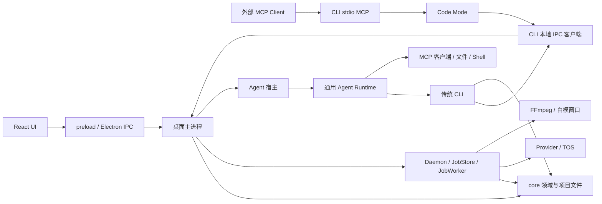

# Canvas Cut：架构与协作入口

本文件适用于整个仓库。当前架构以源码、package.json 和 package-lock.json 为依据；详细职责唯一归属见 [Reference 索引](Reference/README.md)，已存在的重叠见 [问题记录](Reference/issues.md)。产品使用说明见 [README](README.md)，阶段与历史验收见 [PLAN](PLAN.md)。

## 技术架构

Canvas Cut 是本地生成式视频创作应用：节点画布产生图片/视频，时间线编排素材，Electron 主进程执行长任务；CLI、内置 Agent 和对外 MCP 提供自动化入口。项目目前仍为原型，代码存在不等于真实创作效果已验收。

| 层次 | 实际技术栈（manifest 声明） |
| --- | --- |
| 工程 | npm workspaces、Node.js >=20、TypeScript ^5.7.2、严格类型检查、TS project references；Node 包编译为 CommonJS，renderer 由 Vite 打包。 |
| 桌面与 UI | Electron ^33.2.1、React/React DOM ^18.3.1、Vite ^6.0.5、reactflow ^11.11.4；自研时间线，HTML video/audio/img 预览。 |
| 本地白模 | three ^0.186.1；独立 Electron 渲染窗口生成帧，再交 FFmpeg 编码。 |
| 数据与生成 | 项目 JSON/文件锁/原子写，better-sqlite3 ^11.7.0 保存任务且有 JSON 兜底；火山方舟 Provider、@volcengine/tos-sdk ^2.9.1。 |
| Agent | ai ^7.0.68、@ai-sdk/openai ^4.0.43、@ai-sdk/deepseek ^3.0.67、@modelcontextprotocol/sdk ^1.30.0、node-pty 1.1.0、YAML、Ajv。当前没有 Mastra 依赖。 |
| Code Mode | quickjs-emscripten ^0.31.0、Node Worker、Ajv；受限 JavaScript 工具编排。 |
| 校验与媒体 | Ajv ^8.20.0；core/agent 声明 Zod ^3.24.1，根包另声明 ^4.4.3，勿视为统一版本；外部 FFmpeg/ffprobe。 |

精确安装版本以 lockfile 为准。原生 SQLite/PTY 的 Node 与 Electron ABI 需要各自匹配；不得把仅 Vite 开发服务视为完整桌面应用。

## 包依赖与调用链

```text
apps/desktop -> packages/core, packages/agent
apps/cli     -> packages/core, packages/codemode
packages/core / packages/agent / packages/codemode 无相互 workspace 包依赖
desktop 的 TS 构建还引用 apps/cli；Agent launcher 运行 CLI 的构建产物
```



图中的协作不代表共享职责所有权：业务规则归 core 的领域模块；任务生命周期与数据库归桌面任务模块；UI 只维护交互与展示状态；preload/local IPC 只传输、认证和适配。Agent Runtime 与 Code Mode 的权限和隔离模型不同，见各自说明。

## 模块边界与修改规则

1. 开始修改前从 Reference 找到唯一归属模块，阅读其负责/不负责事项、接口和边界偏差；新增职责先指定归属，再设计调用关系。
2. 领域规则、参数语义与缓存键不在 UI、CLI 或 MCP 中重复实现。已有 CLI/桌面重复编排按问题记录说明，不宣称已经收敛。
3. core 不依赖 Electron/React；agent 不嵌入 Canvas Cut 业务或依赖 core；codemode 不自行承担画布、任务或模型会话业务。
4. renderer 不直接访问项目文件、凭证、SQLite 或启动系统进程；新增桥接能力在 preload 白名单和主进程处理入口配套维护。
5. 任务提交返回 jobId；完成、失败、取消以任务终态为准。Agent run、Code Mode execute 和业务 job 的取消语义分别归属各模块，不能互相替代。
6. 每次代码改动都必须在同一次变更中同步更新所属 Reference 模块文档及其他受影响文档，反映当前行为、接口、职责边界和验证入口；其他文档通过链接引用。共享文件的物理归属不等于所有领域语义都归公共模块。
7. 保留用户工作区的未提交改动、示例项目和媒体资料。不要为整理架构文档运行旧 patch/fix 脚本、覆盖用户数据或写入凭证。
8. AGENTS.md 总行数不得超过 100 行（包含空行、表格和代码块），每次修改后检查行数。内容超限时，将详细说明移至对应 Reference 模块文档，本文件只保留概要和链接。

## 构建与验证

在仓库根目录运行：

```powershell
npm run typecheck
npm run build
npm test
npm run test:codemode
npm run start:desktop
npm run dev:desktop:app
```

按修改范围选择验证，不机械地重复所有命令。文档变更检查本地链接、源码归属、迁移覆盖和 git diff --check；业务改动运行所属模块的行为测试，再按需要构建桌面端。测试入口与真实验收边界见 [工程说明](Reference/modules/engineering.md)。构建不产出安装包；mock 模型/Provider 测试不证明真实生成质量。

## 文档导航

- [Reference](Reference/README.md)：模块归属、目录映射及阅读顺序。
- [产品范围](Reference/product.md)：创作场景、验收标准、非目标。
- [架构问题](Reference/issues.md)：源码证据、影响、目标边界和待整改项。
- [必要决策](Reference/decisions.md)：保留历史选择及其当前状态。
- [迁移对照](Reference/migration.md)：旧内容的新归属，防止漏迁或重复声明。
