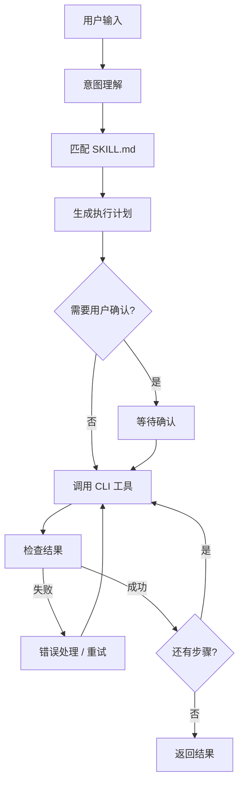

# SKILL.md 与 Agent 编排设计

> 状态：设计阶段，尚未实现
> 更新日期：2026-08-15

## 1. 设计目标

- 用 SKILL.md 封装可复用的创作工作流
- Agent 通过读取 SKILL.md 理解任务
- Agent 通过 CLI 工具执行具体操作
- 支持自然语言和分镜脚本输入

## 2. SKILL.md 规范

### 2.1 文件结构

```markdown
---
name: storyboard-to-video
description: 把分镜脚本转成完整视频
version: 1.0.0
inputs:
  - name: storyboard
    type: text
    required: true
    description: 分镜脚本文本
  - name: output_path
    type: string
    required: true
    description: 导出路径
triggers:
  - 分镜脚本
  - 多镜头视频
  - storyboard
---

# 执行步骤

## 1. 解析分镜脚本
读取 storyboard，提取镜头列表：描述、时长、风格。

## 2. 为每个镜头创建画布
调用 `canvas create`，并添加生成节点。

## 3. 渲染画布
调用 `canvas render` 获取 jobId，用 `job wait` 等待完成。

## 4. 组装时间线
调用 `timeline add-clip --kind canvas` 按顺序加入。

## 5. 添加字幕和背景音乐
调用 `timeline add-subtitle` 和 `timeline add-audio`。

## 6. 导出
调用 `timeline export --output {output_path}`。
```

### 2.2 frontmatter 字段

| 字段 | 必填 | 说明 |
| --- | --- | --- |
| name | 是 | 技能唯一名称 |
| description | 是 | 技能用途，用于匹配 |
| version | 否 | 版本号 |
| inputs | 否 | 输入参数列表 |
| outputs | 否 | 输出说明 |
| triggers | 否 | 触发关键词 |

输入参数结构：

```yaml
inputs:
  - name: storyboard
    type: text
    required: true
    default: ""
    description: 分镜脚本文本
```

### 2.3 正文约定

- 使用 Markdown
- 步骤按顺序编写
- 步骤中引用 CLI 工具或命令
- 使用 `{input_name}` 引用输入参数

## 3. 技能加载与匹配

技能目录：

- 内置技能：随应用打包
- 全局技能：`~/.canvas-cut/skills/`
- 项目技能：`<project>/skills/`

匹配方式：由 LLM 直接选择技能。

- 提供 `list_skills` 和 `read_skill` 工具
- Agent 根据需要列出技能、读取 SKILL.md
- 暂不引入关键词匹配或向量检索

## 4. CLI 工具注册

Agent 不直接执行字符串命令，而是调用类型化工具：

1. 从 CLI manifest 生成工具定义
2. 每个命令对应一个工具，参数为 JSON schema
3. 工具执行时调用 CLI

```ts
const tools = {
  canvas_create: { ... },
  canvas_node_add: { ... },
  canvas_render: { ... },
  timeline_add_clip: { ... },
  job_wait: { ... },
  timeline_export: { ... }
}
```

## 5. Agent 编排流程



任务分类：

- 简单任务：直接执行，不等待确认
- 复杂任务：先展示执行计划，用户确认后执行

职责：

- 意图理解：判断用户想完成什么任务
- 技能匹配：找到最合适的 SKILL.md
- 计划生成：把技能步骤转成工具调用序列
- 工具调用：执行 CLI
- 错误处理：失败重试、参数修正
- 状态跟踪：记录已完成步骤

## 6. 状态与错误处理

- 任务状态持久化，支持中断恢复
- CLI 工具失败时，Agent 根据错误码决定重试或修正参数
- 生成任务通过 jobId 轮询
- 复杂任务执行前展示计划并等待确认，简单任务直接执行
- 同一应用内支持多个对话并发；每个对话是独立会话，任务通过 `conversationId` 归属，全局并发由主进程 job 队列统一控制

## 7. 框架选型

- 已确定：Mastra
- Mastra 提供 Agent + Workflow + Tools + Memory，支持状态持久化与中断恢复
- 模型访问层基于 Vercel AI SDK（`ai`）与 `@ai-sdk/openai`
- 工具参数校验使用 zod

### 7.1 LLM 接入

- 通过 OpenAI 兼容接口接入
- 配置 Base URL + API Key
- 不绑定具体供应商

## 8. 已确认决策

- LLM 接入：OpenAI 兼容 Base URL + API Key
- human-in-the-loop：复杂任务确认，简单任务直接执行

## 9. 待确认

暂无（火山引擎具体接口等见 PROVIDER_ADAPTER_DESIGN.md）

## 10. Agent 工具列表

### 10.1 文件工具

- 仅允许访问当前项目目录
- `read_file(path)`
- `write_file(path, content)`
- `list_files(dir)`
- `read_json(path)`
- `write_json(path, data)`

### 10.2 命令执行

- `run_shell(command, args, cwd)`
- Windows 使用 PowerShell，macOS 使用 bash
- 该工具是类型化工具中的显式例外
- 安全限制：命令白名单，危险操作需用户确认

### 10.3 任务管理

- `write_todo(items)`：写入或更新当前任务的待办列表

### 10.4 技能工具

- `list_skills()`：列出可用技能
- `read_skill(name)`：读取指定技能的 SKILL.md

### 10.5 CLI 工具

项目：

- `project_init`
- `project_open`
- `project_status`

生成：

- `generate_text_to_image`
- `generate_text_to_video`
- `generate_image_to_image`
- `generate_image_to_video`
- `generate_video_to_video`

任务：

- `job_status`
- `job_wait`
- `job_cancel`
- `job_list`

画布：

- `canvas_create`
- `canvas_get`
- `canvas_node_add`
- `canvas_node_remove`
- `canvas_node_set_param`
- `canvas_edge_connect`
- `canvas_edge_remove`
- `canvas_render`
- `canvas_status`

时间线：

- `timeline_init`
- `timeline_get`
- `timeline_add_track`
- `timeline_add_clip`
- `timeline_add_subtitle`
- `timeline_add_audio`
- `timeline_split_clip`
- `timeline_trim_clip`
- `timeline_move_clip`
- `timeline_set_transform`
- `timeline_set_opacity`
- `timeline_set_speed`
- `timeline_set_volume`
- `timeline_remove_clip`
- `timeline_remove_track`
- `timeline_add_transition`
- `timeline_remove_transition`
- `timeline_export`

预设：

- `preset_save`
- `preset_list`
- `preset_apply`

> 工具清单以 CLI manifest 自动生成为准，本表仅作示意；`canvas_render` 支持 `force` 与 `node` 参数。

### 10.6 工具约定

- 工具参数使用 zod schema
- 错误返回统一结构
- CLI 工具映射到对应命令
