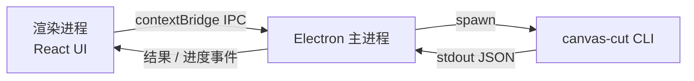
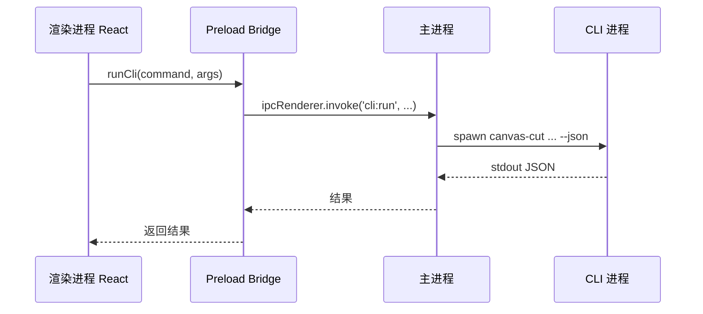
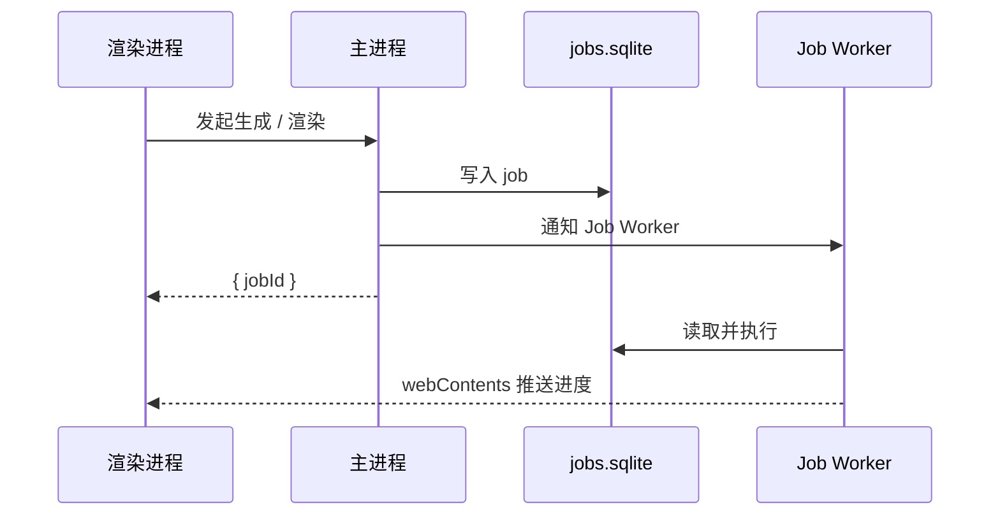

# CLI 命令层设计（CLI DESIGN）

> 状态：设计阶段，尚未实现
> 更新日期：2026-08-15

## 1. 全局约定

- 可执行文件名暂定：`canvas-cut`（短别名待定）
- 所有命令基于项目目录运行，可用 `--project <path>` 指定项目
- 所有命令支持：
  - `--json`：强制 JSON 输出
  - `--dry-run`：只预览不执行
  - `--help`

## 2. 输出统一结构

成功：

```json
{
  "ok": true,
  "data": {},
  "error": null,
  "requestId": "uuid"
}
```

失败：

```json
{
  "ok": false,
  "data": null,
  "error": {
    "code": "GENERATION_TIMEOUT",
    "message": "生成任务超时",
    "retryable": true
  },
  "requestId": "uuid"
}
```

## 3. 退出码

| 退出码 | 含义 |
| --- | --- |
| 0 | 成功 |
| 1 | 一般错误 |
| 2 | 参数/用法错误 |
| 3 | 资源不存在 |
| 4 | 状态冲突 |
| 5 | 超时 |
| 6 | 已取消 |

## 4. 项目状态文件

```text
<project>/
  project.json
  config.json
  canvases/
    <canvasId>.json
  presets/
  timeline/
    timeline.json
  assets/
  cache/
  jobs.sqlite
```

## 5. project 命令

### `project init`

```text
canvas-cut project init --name <name> --path <dir>
```

输出：`{ projectId, path, createdAt }`

### `project open`

```text
canvas-cut project open --path <dir>
```

输出：项目摘要。

### `project status`

```text
canvas-cut project status
```

输出：

```json
{
  "projectId": "...",
  "path": "...",
  "canvasCount": 2,
  "timelineDurationMs": 15000,
  "runningJobs": 1
}
```

## 6. generate 命令

生成命令均返回 `{ jobId }`，调用方通过 job 命令轮询。

### `generate text-to-image`

```text
canvas-cut generate text-to-image \
  --prompt "..." \
  --width 1024 \
  --height 1024 \
  --seed 123 \
  --provider volcengine
```

### `generate text-to-video`

```text
canvas-cut generate text-to-video \
  --prompt "..." \
  --duration-ms 5000 \
  --fps 24 \
  --width 1920 \
  --height 1080 \
  --provider volcengine
```

### `generate image-to-image`

```text
canvas-cut generate image-to-image \
  --image <path> \
  --prompt "..." \
  --strength 0.7 \
  --width 1024 \
  --height 1024 \
  --provider volcengine
```

### `generate image-to-video`

```text
canvas-cut generate image-to-video \
  --image <path> \
  --prompt "..." \
  --duration-ms 5000 \
  --fps 24 \
  --width 1920 \
  --height 1080 \
  --provider volcengine
```

### `generate video-to-video`

```text
canvas-cut generate video-to-video \
  --video <path> \
  --prompt "..." \
  --mode edit|extend \
  --duration-ms 5000 \
  --fps 24 \
  --width 1920 \
  --height 1080 \
  --provider volcengine
```

输出：`{ jobId, type }`

## 7. job 命令

### `job status`

```text
canvas-cut job status <jobId>
```

输出：`GenerationJob`；画布渲染任务额外包含 `children`

### `job wait`

```text
canvas-cut job wait <jobId> --timeout-ms 120000
```

阻塞直到终态或超时。

### `job cancel`

```text
canvas-cut job cancel <jobId>
```

输出：`{ cancelled: true }`

### `job list`

```text
canvas-cut job list --status running
```

输出：任务列表。

## 8. canvas 命令

### `canvas create`

```text
canvas-cut canvas create --name <name>
```

输出：`{ canvasId, version }`

### `canvas get`

```text
canvas-cut canvas get <canvasId>
```

输出：完整节点图 JSON。

### `canvas remove`

```text
canvas-cut canvas remove <canvasId>
```

### `canvas node add`

```text
canvas-cut canvas node add \
  --canvas <canvasId> \
  --type <node-type> \
  --params '{"prompt":"..."}'
```

节点类型：`text-input` / `image-input` / `video-input` / `canvas-reference` / `text-to-image` / `text-to-video` / `image-to-image` / `image-to-video` / `video-to-video` / `output`

输出：`{ nodeId }`

### `canvas node remove`

```text
canvas-cut canvas node remove --canvas <canvasId> --node <nodeId>
```

### `canvas node set-param`

```text
canvas-cut canvas node set-param \
  --canvas <canvasId> \
  --node <nodeId> \
  --params '{"prompt":"new prompt"}'
```

### `canvas edge connect`

```text
canvas-cut canvas edge connect \
  --canvas <canvasId> \
  --from <nodeId>:<port> \
  --to <nodeId>:<port>
```

输出：`{ edgeId }`

### `canvas edge remove`

```text
canvas-cut canvas edge remove --canvas <canvasId> --edge <edgeId>
```

### `canvas render`

```text
canvas-cut canvas render \
  --canvas <canvasId> \
  [--node <nodeId>] \
  [--force]
```

输出：`{ jobId, childJobIds }`

画布始终按导出分辨率生成一次；预览由本地低清代理完成。

`--force`：重新生成，绕过节点缓存。
`--node <nodeId> --force`：只重跑指定节点及其下游，不整图重跑。

画布渲染采用父子任务树：

- 父任务：CanvasRenderJob
- 子任务：每个需要执行的生成节点对应一个 NodeJob
- `job status <jobId>` 返回父任务状态和子任务列表

### `canvas status`

```text
canvas-cut canvas status <canvasId>
```

输出：节点状态与版本。

## 9. timeline 命令

### `timeline init`

```text
canvas-cut timeline init
```

分辨率 / 帧率继承 `project.json` 的 `settings.width / height / fps`，`timeline init` 不再接收这三个参数。

### `timeline get`

```text
canvas-cut timeline get
```

输出：完整时间线 JSON。

### `timeline add-track`

```text
canvas-cut timeline add-track --type video|audio|subtitle|image --name <name>
```

输出：`{ trackId }`

### `timeline add-clip`

```text
canvas-cut timeline add-clip \
  --track <trackId> \
  --kind media|canvas \
  --asset <path> \
  --canvas <canvasId> \
  --start-ms 0 \
  --duration-ms 5000
```

`kind=media` 使用 `--asset`，`kind=canvas` 使用 `--canvas`。

输出：`{ clipId }`

### `timeline add-subtitle`

```text
canvas-cut timeline add-subtitle \
  --track <trackId> \
  --text "..." \
  --start-ms 0 \
  --duration-ms 2000
```

### `timeline add-audio`

```text
canvas-cut timeline add-audio \
  --track <trackId> \
  --asset <path> \
  --start-ms 0
```

### `timeline split-clip`

```text
canvas-cut timeline split-clip --clip <clipId> --at-ms 2500
```

### `timeline trim-clip`

```text
canvas-cut timeline trim-clip --clip <clipId> --in-ms 1000 --out-ms 4000
```

### `timeline move-clip`

```text
canvas-cut timeline move-clip --clip <clipId> --start-ms 2000
```

### `timeline set-transform`

```text
canvas-cut timeline set-transform \
  --clip <clipId> \
  --x 0 --y 0 --scale 1 --rotation 0
```

### `timeline set-opacity`

```text
canvas-cut timeline set-opacity --clip <clipId> --opacity 0.8
```

### `timeline set-speed`

```text
canvas-cut timeline set-speed --clip <clipId> --speed 1.5
```

### `timeline set-volume`

```text
canvas-cut timeline set-volume --clip <clipId> --volume 0.8
```

### `timeline remove-clip`

```text
canvas-cut timeline remove-clip --clip <clipId>
```

### `timeline remove-track`

```text
canvas-cut timeline remove-track --track <trackId>
```

### `timeline add-transition`

```text
canvas-cut timeline add-transition \
  --clip <clipId> \
  --type crossfade \
  --duration-ms 500
```

### `timeline remove-transition`

```text
canvas-cut timeline remove-transition --clip <clipId>
```

### `timeline export`

```text
canvas-cut timeline export \
  --profile 1080p \
  --output <path>
```

输出：`{ jobId }`

## 10. preset 命令

### `preset save`

```text
canvas-cut preset save --canvas <canvasId> --name <name>
```

输出：`{ presetId }`

### `preset list`

```text
canvas-cut preset list
```

### `preset apply`

```text
canvas-cut preset apply --preset <presetId> --name <canvasName>
```

输出：`{ canvasId }`

## 11. dry-run 语义

- 状态变更命令：输出将要产生的状态变化，不落盘
- 生成命令：输出将要发送的请求参数，不调用 Provider
- 渲染命令：输出将要执行的渲染计划，不启动渲染

## 12. 错误码

通用错误码：

```text
PROJECT_NOT_FOUND
PROJECT_EXISTS
CANVAS_NOT_FOUND
NODE_NOT_FOUND
EDGE_INVALID
INVALID_PARAMS
ASSET_NOT_FOUND
JOB_NOT_FOUND
JOB_CANCELLED
DAEMON_UNAVAILABLE
GENERATION_TIMEOUT
PROVIDER_ERROR
RENDER_FAILED
```

## 13. CLI 与 Electron 渲染进程的通信

渲染进程不直接执行 CLI，由 Electron 主进程代理调用。

### 13.0 总览



### 13.1 一次性命令时序



执行步骤：

1. 渲染进程调用预加载桥接方法，例如 `window.api.runCli(command, args)`
2. 主进程执行 `canvas-cut <command> <args> --json`
3. 主进程解析 stdout JSON
4. 主进程把结果返回给渲染进程

### 13.2 长任务时序



执行步骤：

1. UI 长任务直接调用主进程内部 API，不 spawn CLI
2. 外部 CLI / Agent 通过本地 IPC 将任务投递给主进程
3. 主进程写入 jobs.sqlite 并通知 Job Worker，返回 jobId
4. Worker 读取并执行任务，更新 jobs.sqlite 状态
5. 主进程通过 `webContents.send('job:update', job)` 推送进度；外部调用方轮询 job status

使用前提：生成/渲染任务依赖 Electron 主进程运行；独立 CLI 无主进程时不执行。

### 13.3 共享状态

- CLI 与 Electron UI 操作同一项目目录
- jobs.sqlite 仅在主进程读写；项目 JSON 状态文件由 CLI 短命令与主进程共同读写，统一通过 `.lock` 串行化
- 可选使用文件监听同步 UI 状态

### 13.4 安全

- 渲染进程保持沙箱
- 只暴露最小的类型化 API
- 主进程校验命令白名单和参数

### 13.5 本地 IPC 协议（N1）

详细设计见 `LOCAL_IPC_PROTOCOL.md`。

- 传输与发现：Windows 命名管道 / macOS Unix domain socket；CLI 通过固定路径或端口文件定位主进程
- 多实例区分：按项目目录或主进程实例 id 区分，避免多窗口 / 多项目串扰
- 协议：请求 / 响应均为 JSON，含 `requestId`；大 payload（如 `request_snapshot`）优先写入临时文件再传路径引用
- 超时：默认超时 + 可配置；幂等命令可安全重试
- 无主进程行为：`generate` / `canvas render` / `timeline export` / `job status` 等依赖主进程的命令返回 `DAEMON_UNAVAILABLE`；`project status` 等纯本地状态命令仍可执行

## 14. CLI 运行时与打包

- 运行时：Node.js，与 Electron 主进程保持一致
- 构建：esbuild 打成单文件
- 打包：`@yao-pkg/pkg` 或 Node SEA 生成独立可执行文件
- FFmpeg 保持外部 sidecar，不打包进 CLI
- CLI 不直接访问 SQLite；jobs.sqlite 由 Electron 主进程唯一读写
- 主进程使用 `better-sqlite3`，Electron 侧 electron-rebuild
