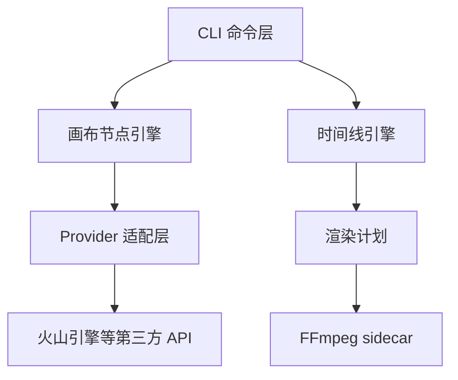

# 核心引擎设计草案（CORE ENGINE DESIGN）

> 状态：设计阶段，尚未实现
> 更新日期：2026-08-15

## 1. 设计范围

核心引擎包含三个部分：

1. Provider 适配层：统一第三方生成 API
2. 画布节点引擎：节点 DAG、执行、缓存、任务管理
3. 时间线数据模型：轨道、片段、剪辑操作、渲染计划



## 2. Provider 适配层

### 2.1 统一接口

```ts
interface GenerationProvider {
  id: string
  capabilities: {
    textToImage: boolean
    textToVideo: boolean
    imageToImage: boolean
    imageToVideo: boolean
    videoToVideo: boolean
  }
  textToImage(req: TextToImageRequest): Promise<GenerationJob>
  textToVideo(req: TextToVideoRequest): Promise<GenerationJob>
  imageToImage(req: ImageToImageRequest): Promise<GenerationJob>
  imageToVideo(req: ImageToVideoRequest): Promise<GenerationJob>
  videoToVideo(req: VideoToVideoRequest): Promise<GenerationJob>
  getJob(jobId: string): Promise<GenerationJob>
  cancelJob(jobId: string): Promise<void>
}
```

### 2.2 请求与结果类型

```ts
interface TextToImageRequest {
  prompt: string
  negativePrompt?: string
  width: number
  height: number
  seed?: number
  style?: string
  extra?: Record<string, unknown>
}

interface TextToVideoRequest {
  prompt: string
  negativePrompt?: string
  durationMs?: number
  fps?: number
  width?: number
  height?: number
  seed?: number
  motionStrength?: number
  extra?: Record<string, unknown>
}

interface ImageToImageRequest {
  image: AssetRef
  prompt: string
  negativePrompt?: string
  strength?: number
  width?: number
  height?: number
  seed?: number
  extra?: Record<string, unknown>
}

interface ImageToVideoRequest {
  image: AssetRef
  prompt: string
  negativePrompt?: string
  durationMs: number
  fps?: number
  width?: number
  height?: number
  seed?: number
  motionStrength?: number
  extra?: Record<string, unknown>
}

interface VideoToVideoRequest {
  video: AssetRef
  prompt: string
  mode: 'edit' | 'extend'
  durationMs?: number
  fps?: number
  width?: number
  height?: number
  seed?: number
  motionStrength?: number
  extra?: Record<string, unknown>
}
```

### 2.3 统一任务抽象

所有供应商都返回统一的 `GenerationJob`，引擎统一轮询，屏蔽同步/异步差异。

```ts
type GenerationStatus =
  | 'pending'
  | 'running'
  | 'succeeded'
  | 'failed'
  | 'cancelled'

interface GenerationJob {
  jobId: string
  providerId: string
  type: 'text-to-image' | 'text-to-video' | 'image-to-image' | 'image-to-video' | 'video-to-video'
  status: GenerationStatus
  progress?: number
  result?: AssetRef
  error?: {
    code: string
    message: string
    retryable: boolean
  }
  createdAt: number
  updatedAt: number
}
```

### 2.4 资产引用

```ts
interface AssetRef {
  id: string
  path: string
  type: 'image' | 'video' | 'audio'
  width?: number
  height?: number
  durationMs?: number
  sizeBytes: number
}
```

### 2.5 Provider 待定项

- 火山引擎具体接口、模型名、端点
- API Key 由用户提供还是平台统一代理

## 3. 画布节点引擎

### 3.1 图数据模型

```ts
interface CanvasGraph {
  id: string
  version: number
  graphHash: string
  nodes: CanvasNode[]
  edges: CanvasEdge[]
}

interface CanvasNode {
  id: string
  type: NodeType
  params: Record<string, unknown>
  inputs: NodePort[]
  outputs: NodePort[]
  status: NodeStatus
  cachedResult?: AssetRef
}

interface CanvasEdge {
  id: string
  source: string
  sourcePort: string
  target: string
  targetPort: string
}
```

完整画布协议（节点注册表、端口校验、graphHash / 缓存键规范化、CanvasReference、preset schema）见 `CANVAS_PROTOCOL.md`。

### 3.2 节点类型与端口

| 节点类型 | 输入 | 输出 |
| --- | --- | --- |
| TextInput | - | text |
| ImageInput | - | image |
| VideoInput | - | video |
| CanvasReference | - | video |
| TextToImage | text | image |
| TextToVideo | text | video |
| ImageToImage | image, text | image |
| ImageToVideo | image, text | video |
| VideoToVideo | video, text | video |
| Output | image / video | image / video |

### 3.3 执行器

1. 校验图：无环、端口类型匹配、必填输入完整
2. 拓扑排序得到执行顺序
3. 计算每个节点的缓存键：`hash(nodeType + params + 输入资产 + 输入文本 + 分辨率)`
4. 检查缓存；普通渲染命中则复用，显式 reroll 时绕过缓存
5. 按顺序执行生成节点，调用 Provider
6. 结果写入项目资产目录，更新 `cachedResult`
7. 渲染结果绑定 `(canvasId, graphHash)`，而非自增版本号

prompt 双通道规则：

- 连线优先：有连线输入时，连线上游的输出作为主输入
- `params` 作为默认值：未连线时回退到 `params` 中的 prompt 等字段

图变更语义：

- 任何节点/边/参数变更，立即递增 `version` 并重算 `graphHash`
- 时间线通过 `graphHash` 判断画布片段是否 stale
- `graphHash` 必须基于规范化序列化计算（对象键排序、边按稳定顺序排列），否则同一张图因写入顺序不同会得到不同哈希

### 3.4 任务状态机

```text
pending -> running -> succeeded
                   -> failed
                   -> cancelled
```

每个节点和整个画布都有独立状态。

### 3.5 缓存与增量更新

- 缓存粒度：节点级
- 缓存键：`hash(nodeType + params + 输入资产 + 输入文本 + 分辨率)`
- 缓存：SQLite 存元数据，文件系统存资产
- 普通渲染：缓存命中则复用
- 重新生成：显式 `reroll` / `--force` 绕过缓存
- 节点级重 roll：`canvas render --node <nodeId> --force`，只重跑指定节点及其下游，避免整图重跑
- MVP：可先整图重跑，但复用节点级缓存
- 后续：只重跑变更节点及其下游

### 3.6 画布输出确认

- Output 节点输入与输出均支持 image 或 video
- 画布结果可能是图片或视频，时间线画布片段同样支持两者

### 3.7 任务管理与并发

- 生成命令返回 `jobId`，调用方轮询状态
- 任务持久化到 SQLite，可跨进程查询
- 并发上限默认 3，可通过配置调整
- CLI 提供：
  - `job status <jobId>`
  - `job wait <jobId>`
  - `job cancel <jobId>`

### 3.8 画布渲染任务聚合

- `canvas render` 创建父任务 CanvasRenderJob
- 每个需要执行的生成节点创建子任务 NodeJob
- 父任务状态由子任务聚合
- 并发上限作用于子任务
- 同一 `canvasId + graphHash` 已有 running 任务时去重，避免重复付费

子画布规则：

- 渲染画布时，先递归渲染被引用的子画布
- 子画布 `graphHash` 变化时，父画布相关缓存失效
- 建立 CanvasReference 时校验：被引用子画布不得再包含 CanvasReference（最多两层）
- 反向校验：已被其他画布引用的画布，禁止再添加 CanvasReference 节点（`canvas node add --type canvas-reference` 时检查），防止形成 A → B → C 三层

### 3.9 重启恢复 reconcile

Worker 启动时对 `jobs.sqlite` 中遗留 `running` 状态的任务执行 reconcile：

1. 有 `provider_task_id` 的，先查询云端任务状态
2. 云端已成功：下载结果并置为 `succeeded`
3. 云端仍运行：继续轮询，保持 `running`
4. 云端任务不存在或查询失败：置为 `failed`，并保留可重试的错误信息
5. 本地无 `provider_task_id` 的孤儿任务：置为 `failed`

## 4. 时间线数据模型

### 4.1 轨道与片段

```ts
interface Timeline {
  id: string
  tracks: Track[]
}

interface Track {
  id: string
  type: 'video' | 'audio' | 'subtitle' | 'image'
  name: string
  clips: Clip[]
}

type Clip =
  | MediaClip
  | CanvasClip
  | SubtitleClip

interface MediaClip {
  id: string
  kind: 'media'
  asset: AssetRef
  startMs: number
  durationMs: number
  inMs: number
  outMs: number
  transform?: {
    x: number
    y: number
    scale: number
    rotation: number
  }
  opacity: number
  blendMode?: string
  speed?: number
  volume?: number
}

interface CanvasClip {
  id: string
  kind: 'canvas'
  canvasId: string
  canvasVersion: number
  canvasGraphHash: string
  startMs: number
  durationMs: number
  renderedAsset?: AssetRef
  status: 'fresh' | 'stale' | 'rendering' | 'failed'
}

CanvasClip 时长语义：

- 生成视频时长与 `durationMs` 不一致时，默认截断
- Seedance `duration=-1` 自适应时，生成完成后回填实际时长

interface SubtitleClip {
  id: string
  kind: 'subtitle'
  text: string
  startMs: number
  durationMs: number
}
```

### 4.2 剪辑操作

- addTrack / removeTrack
- addClip / removeClip
- splitClip
- trimClip
- moveClip
- setTransform
- setOpacity
- setSpeed
- setVolume
- addTransition / removeTransition

### 4.3 渲染计划

时间线数据转换为渲染计划，再由 FFmpeg sidecar 执行：

1. 按时间切分为活动片段集合不变的分段
2. 每个分段生成 filter graph
3. 拼接分段输出

### 4.4 时间线待定项

- 转场类型范围
- 音频轨混音细节
- 字幕样式与烧录方式

## 5. 核心引擎与 CLI / UI 的关系

- CLI 通过本地 IPC 向主进程投递任务，不直接访问 jobs.sqlite
- 主进程唯一拥有 jobs.sqlite 与 Job Worker
- 生成命令返回 jobId，UI 通过 job 命令轮询进度
- 独立 CLI 场景：主进程未运行时，仅支持状态读写，不执行生成/渲染任务

## 6. 开放设计问题

1. 火山引擎具体接口、模型名、端点
2. API Key 由用户提供还是平台统一代理
3. 转场类型范围
4. 音频轨混音细节
5. 字幕样式与烧录方式
6. 任务队列的持久化与重启恢复细节（已设计，见 §3.9）
