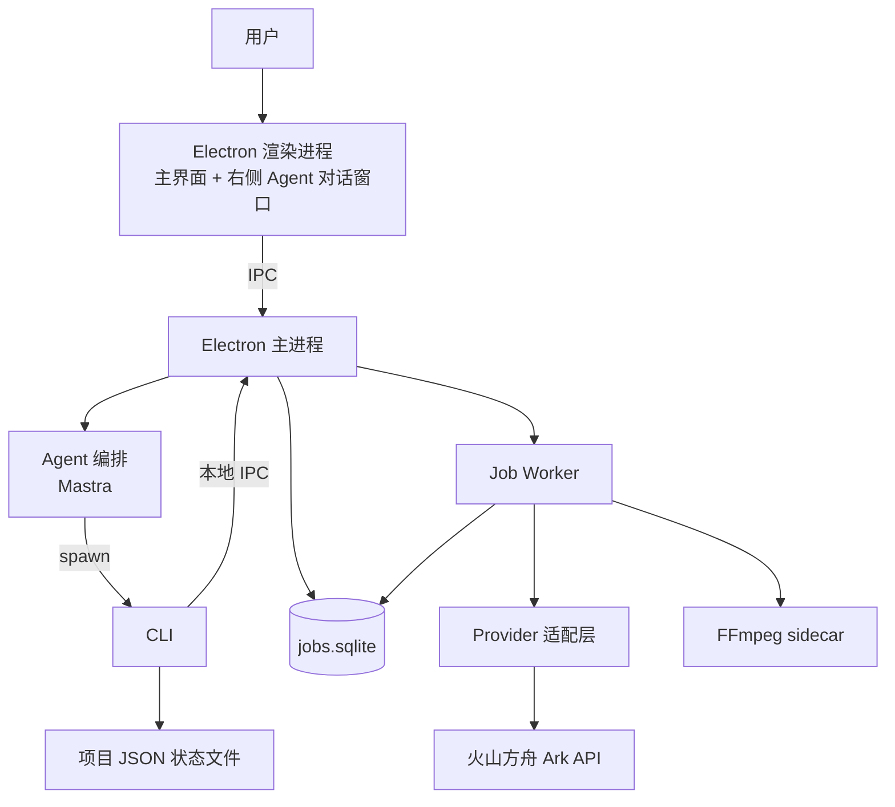
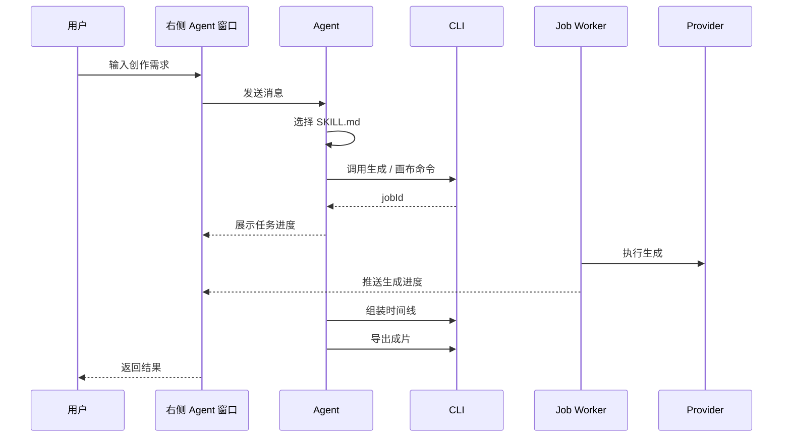
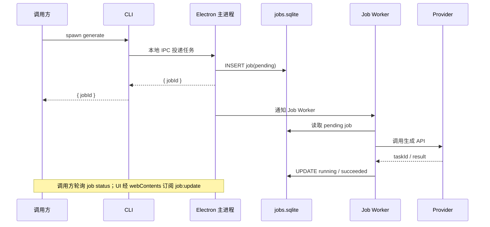
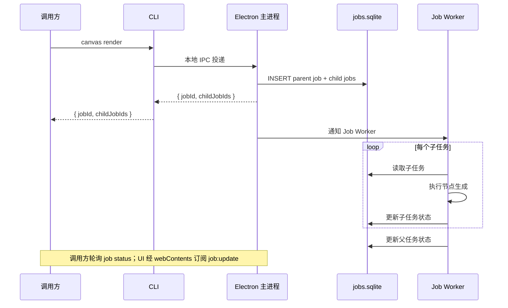
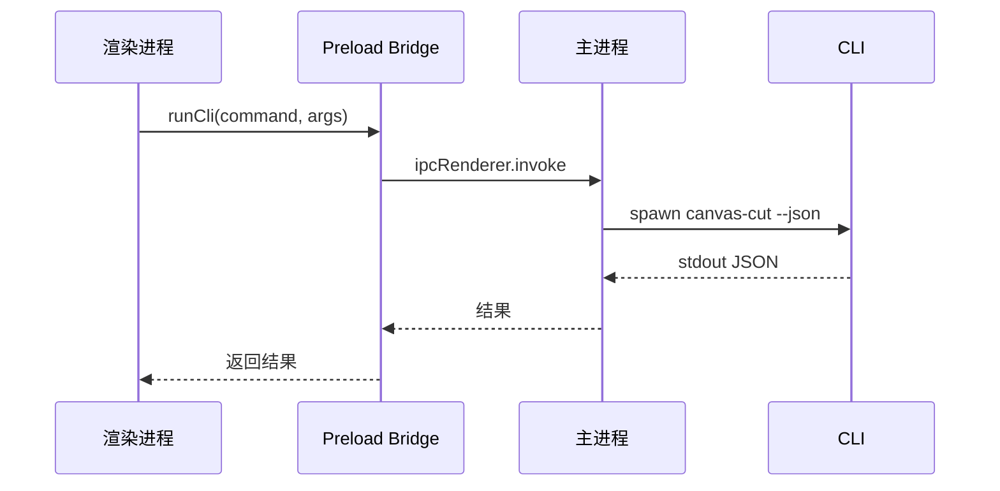
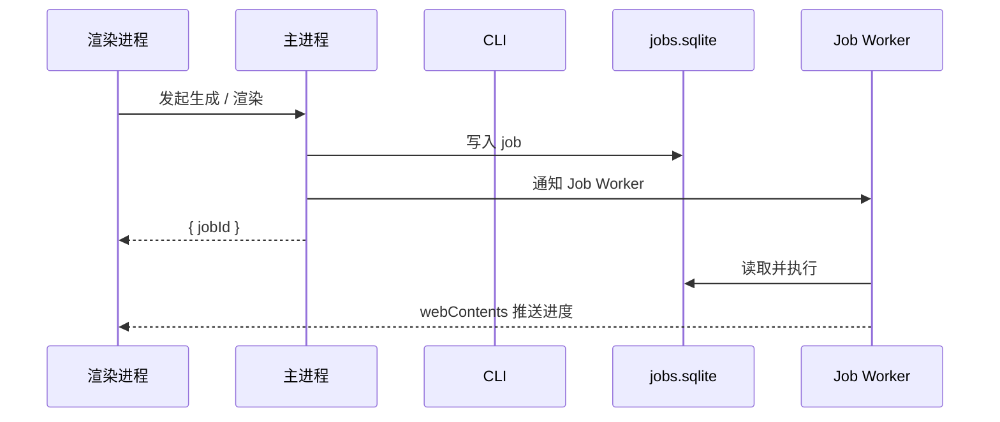
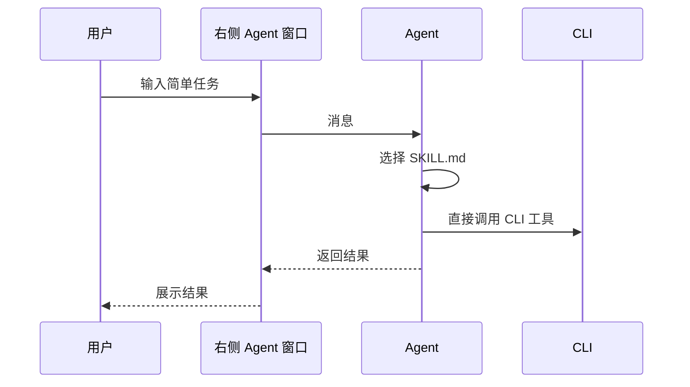
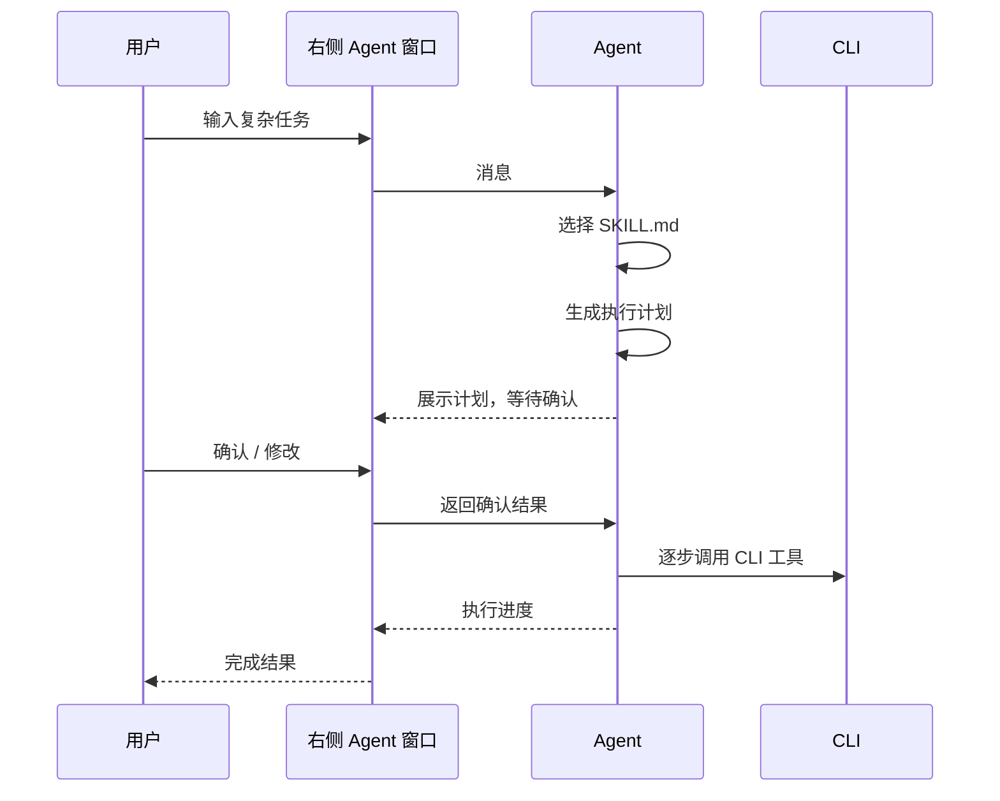
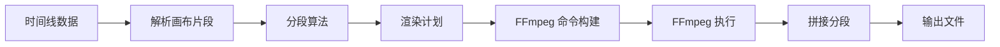
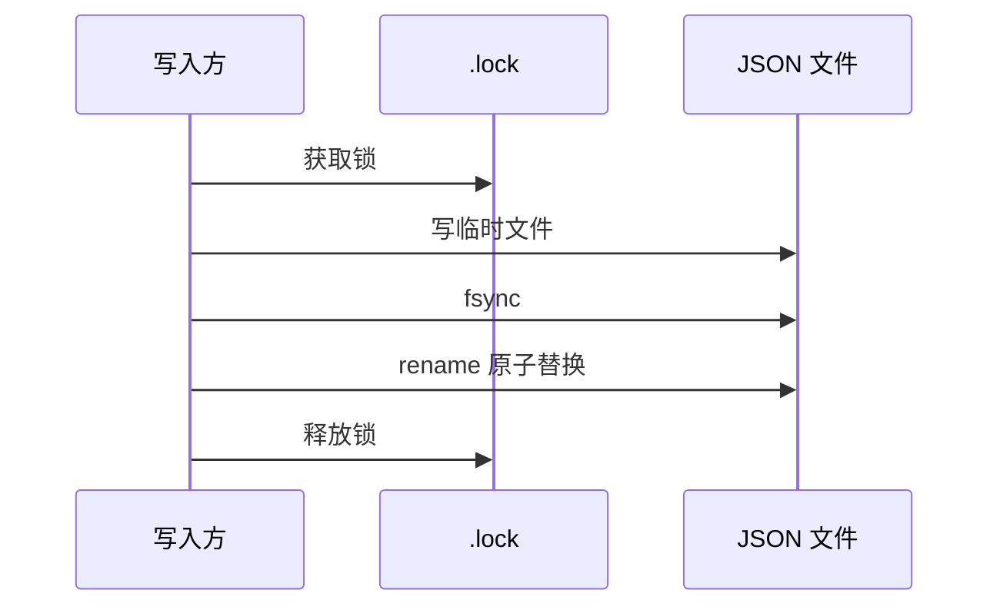

# 流程图与时序图（FLOWS）

> 状态：设计阶段，尚未实现
> 更新日期：2026-08-15

本文档统一定义核心流程与时序。

## 1. 整体架构

## 2. 用户创作主流程

## 3. 生成任务时序

说明：CLI 不直接访问 jobs.sqlite，所有任务通过本地 IPC 投递给主进程；主进程唯一拥有 jobs.sqlite 和 Job Worker。

## 4. 画布渲染时序（父子任务树）

## 5. CLI 与 Electron 通信

### 5.1 一次性命令

### 5.2 长任务命令

## 6. Agent 编排时序

### 6.1 简单任务

### 6.2 复杂任务

## 7. 时间线渲染流程

## 8. 项目状态读写时序

