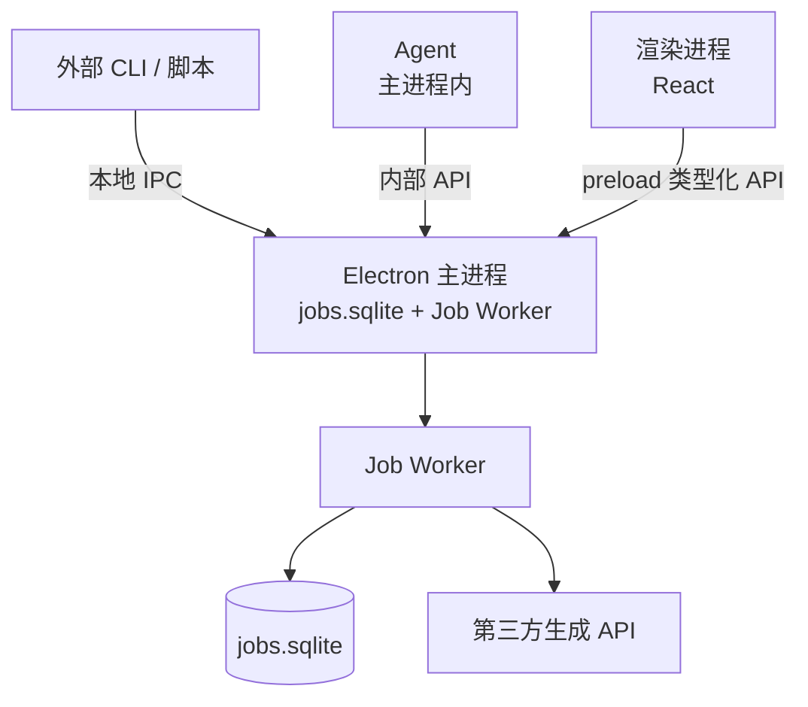
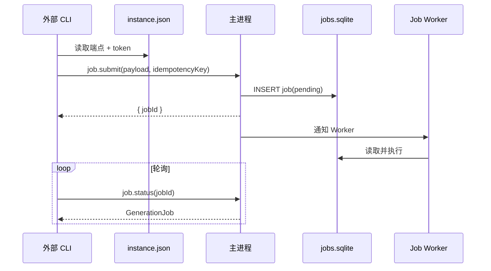
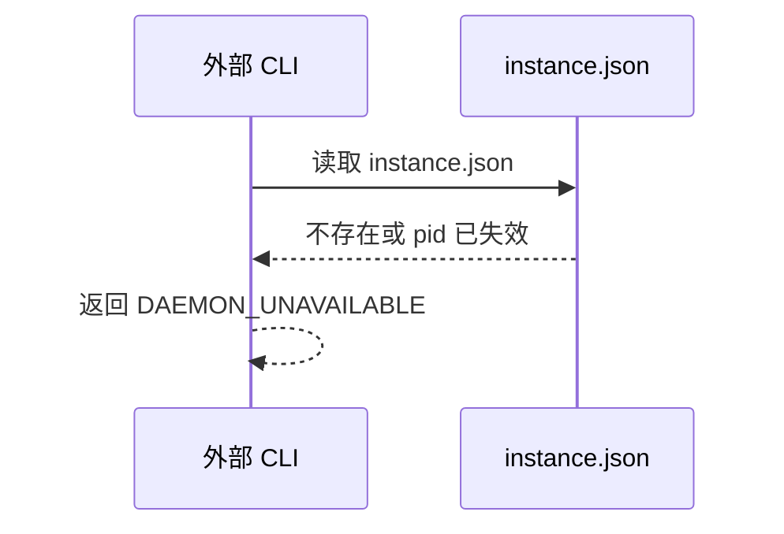
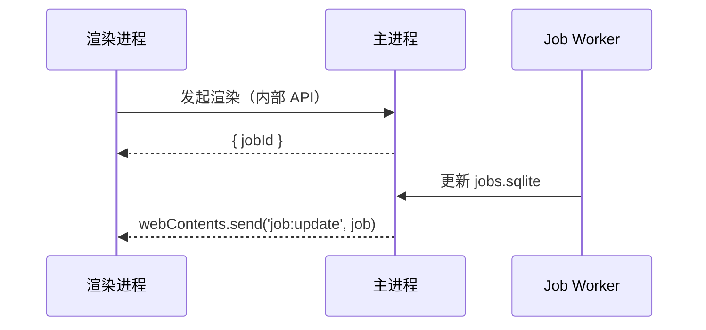

# 本地 IPC 协议设计（LOCAL IPC PROTOCOL）

> 状态：设计阶段，尚未实现
> 更新日期：2026-08-15

## 1. 目标与范围

定义 `canvas-cut` CLI、Agent、Electron 主进程之间的本地进程间通信协议。核心约束：

- Electron 主进程是唯一 `jobs.sqlite` 与 Job Worker 的拥有者
- 独立 CLI 不直接读写 SQLite，长任务通过本地 IPC 投递
- UI 长任务直连主进程内部 API，不 spawn CLI
- 渲染进程不接触原始 IPC，只通过 preload 暴露类型化 API

## 2. 进程拓扑



Agent 在主进程内直接调用内部 API；外部 CLI 与脚本走本地 IPC；两者最终都落到同一套主进程能力。

## 3. 传输与发现

### 3.1 传输层

基于 Node.js `net` 模块抽象为同一种 stream 接口：

- Windows：命名管道 `\\.\pipe\canvas-cut-<instanceId>`
- macOS：Unix domain socket `<userDataDir>/ipc/canvas-cut-<instanceId>.sock`

已确认：MVP 采用单实例模型，Electron 使用 `app.requestSingleInstanceLock()` 保证每个用户同一时间只有一个主进程。多项目通过 `projectPath` 在协议层路由；应用内支持多个 Agent 对话会话（多开对话），通过 `conversationId` 区分，均不依赖多应用实例。

### 3.2 发现机制

主进程启动时在 `<userDataDir>/ipc/instance.json` 原子写入端点信息：

```json
{
  "protocolVersion": 1,
  "instanceId": "uuid",
  "pid": 12345,
  "endpoint": "\\\\.\\pipe\\canvas-cut-uuid" ,
  "token": "random-secret",
  "startedAt": 1730000000000
}
```

- 文件权限尽量收紧（0600）
- CLI 启动时读取 `instance.json`
- `pid` 不存在、文件过期或端点连不上：判定主进程未运行，返回 `DAEMON_UNAVAILABLE`
- 第二实例启动时通过单实例锁把控制权转交给首实例后退出

### 3.3 多项目路由

请求 envelope 携带 `projectPath`，主进程据此路由到对应项目；未指定时使用 CLI 当前工作目录推断。

多对话路由：请求可携带 `conversationId`，把 `job:update` 等事件定向到对应 Agent 对话窗口。

## 4. 协议格式

### 4.1 请求 envelope

```json
{
  "protocolVersion": 1,
  "requestId": "uuid",
  "method": "job.submit",
  "projectPath": "C:/work/my-project",
  "idempotencyKey": "uuid",
  "conversationId": "uuid",
  "payload": {},
  "sentAt": 1730000000000
}
```

`conversationId` 可选，用于多对话场景的事件路由；未提供时按 `projectPath` 默认。

### 4.2 响应 envelope

```json
{
  "protocolVersion": 1,
  "requestId": "uuid",
  "ok": true,
  "data": {},
  "error": null
}
```

失败：

```json
{
  "protocolVersion": 1,
  "requestId": "uuid",
  "ok": false,
  "data": null,
  "error": {
    "code": "DAEMON_UNAVAILABLE",
    "message": "Electron 主进程未运行",
    "retryable": false
  }
}
```

### 4.3 大 payload

`payload` 超过 256KB（如 `request_snapshot` 或 base64 图片）时，写入临时文件，envelope 中改传：

```json
{
  "ref": {
    "path": "<tmp>/payload-<requestId>.json",
    "sha256": "..."
  }
}
```

主进程读取后立即删除临时文件。

## 5. 方法集

| method | 说明 | 是否幂等 |
| --- | --- | --- |
| `ping` | 健康检查 | 是 |
| `job.submit` | 提交生成/渲染/导出任务，返回 jobId | 是（用 idempotencyKey） |
| `job.status` | 查询任务状态 | 是 |
| `job.wait` | 阻塞等待终态或超时 | 是 |
| `job.cancel` | 取消任务 | 是 |
| `job.list` | 列出任务 | 是 |
| `state.read` | 读取项目状态（canvas / timeline / preset） | 是 |
| `state.write` | 短命令状态变更 | 视命令而定 |
| `command.dispatch` | 按 CLI manifest 透传短命令（可选） | 否 |

`job.submit` 的 `payload.type` 支持：

- `generate.text-to-image`
- `generate.image-to-image`
- `generate.image-to-video`
- `canvas.render`
- `timeline.export`

短命令优先走类型化 `state.read` / `state.write`；`command.dispatch` 仅作为兜底，不推荐 UI 使用。

## 6. 超时、重试与幂等

- `ping` / `state.read`：默认超时 5s
- `job.submit` 确认：默认超时 30s
- `job.wait`：由客户端指定 `timeoutMs`，主进程用长轮询返回
- 幂等：`job.submit` 使用 `idempotencyKey`，主进程在 TTL 内去重，避免重复提交产生重复计费
- 传输层错误（连接中断、超时）：对幂等方法可安全重试；对 `job.submit` 沿用同一 `idempotencyKey` 重试
- `DAEMON_UNAVAILABLE` 不自动重试，提示用户启动应用

## 7. 错误码

```text
DAEMON_UNAVAILABLE   主进程未运行
IPC_TIMEOUT          本地 IPC 超时
IPC_AUTH_FAILED      认证 token 不匹配
IPC_BAD_REQUEST      envelope 或 method 非法
IPC_PROTOCOL_VERSION 协议版本不支持
```

领域错误码（`PROVIDER_ERROR`、`GENERATION_TIMEOUT` 等）原样透传，见 `CLI_DESIGN.md`。

## 8. 安全

- 端点认证：`instance.json` 中的随机 token，主进程校验
- Windows 可选：把命名管道 ACL 限制到当前用户
- 渲染进程沙箱：不开放原始 IPC，只暴露 preload 类型化 API
- 主进程校验 method 白名单与参数 schema（由 CLI manifest 生成）
- `run_shell` / 文件工具：限制项目目录，危险操作需用户确认（见 `AGENT_ORCHESTRATION_DESIGN.md`）

## 9. 生命周期

- 主进程未运行：返回 `DAEMON_UNAVAILABLE`
- 主进程崩溃：CLI 重连时重新读取 `instance.json`；旧端点失效后进入 `DAEMON_UNAVAILABLE`
- 主进程重启：Job Worker 对遗留 running 任务执行 reconcile（见 `CORE_ENGINE_DESIGN.md` §3.9）
- 优雅退出：主进程关闭 socket 前拒绝新请求，等待在途请求完成

## 10. 时序图

### 10.1 外部 CLI 提交生成任务



### 10.2 无主进程



### 10.3 UI 进度推送



## 11. 待定项

- 已确认：单实例，不支持多应用实例；多项目由 projectPath 路由，多对话由 conversationId 路由
- 命名管道 / Unix socket 之上的帧协议是否引入长度前缀 + 分帧，还是 MVP 先按换行分隔 JSON
- `job.wait` 长轮询的精确超时与心跳间隔
