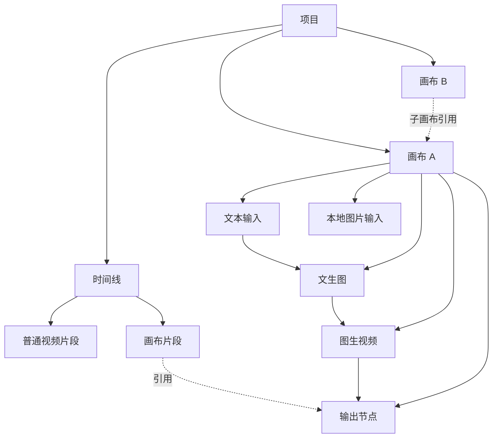
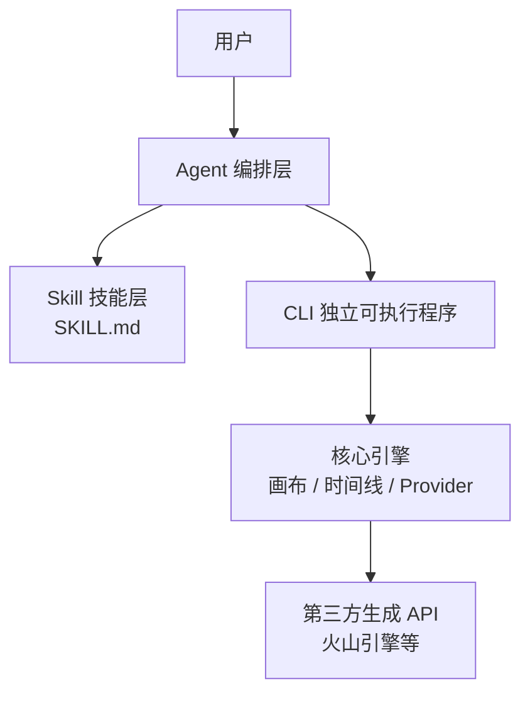

# 生成式视频创作工具 - 产品需求文档（PRD）

> 状态：草稿（计划阶段，尚未实现）
> 更新日期：2026-08-15

## 1. 产品概述

### 1.1 一句话定义

一款面向普通用户的桌面端生成式视频创作工具。用户既可以使用多轨道时间线剪辑视频，也可以通过节点式「画布」完成 AI 生成，并把生成结果作为智能片段放入时间线。生成能力通过第三方 API 接入。

### 1.2 核心定位

**「剪映式时间线」 + 「ComfyUI 式生成画布」 + 「Agent 自动编排」**

### 1.3 解决的问题

传统剪辑工具要求用户先有素材，再进行后期编辑。本产品让用户可以从一个想法、一段文字、一张图片或一段分镜脚本出发，先通过 AI 生成素材，再完成剪辑与导出。

### 1.4 目标用户

- 短视频创作者
- 电商/产品营销人员
- 需要快速产出宣传视频的中小团队
- 对 AI 生成能力感兴趣但缺乏复杂工具使用经验的普通用户

## 2. 核心概念

### 2.1 双视图模型

一个项目包含两种创作视图，共享同一个作品：

- **时间线（多轨道）视图**：负责片段编排、剪辑、导出，类似剪映。
- **画布（节点式）视图**：每个画布是一张节点图，通过生成节点最终产出一个视频。

时间线上的某个视频片段可以是：

1. **普通媒体片段**：本地视频、图片、音频等。
2. **画布片段**：对某个画布输出节点的引用。

### 2.2 核心关系图



## 3. 关键设计决策

以下决策已确认：

| 主题 | 决策 |
| --- | --- |
| 画布范围 | 只做生成链，不包含通用合成/调色节点 |
| 更新策略 | 惰性更新：画布变化后片段标记为「已过期」，用户手动点击更新 |
| 嵌套层级 | 最多两层：画布可引用子画布，子画布不能再嵌套 |
| 预设 | 画布可保存为预设，保存结构 + 参数 + 输入槽位 |
| Agent | Agent 可自动搭建和修改节点图 |
| 节点可视化 | 每个节点展示中间结果（图片缩略图 / 视频预览） |

## 4. 功能范围

### 4.1 AI 生成能力

- 文生图（Text to Image）
- 文生视频（Text to Video）
- 图生图（Image to Image）
- 图生视频（Image to Video）
- 视频编辑 / 视频延长（Video Edit / Extend，Seedance 2.5）

### 4.2 画布（节点式生成链）

节点类型：

- 输入节点：
  - 文本输入
  - 本地图片输入
  - 本地视频输入
  - 子画布引用
- 生成节点：
  - 文生图
  - 文生视频
  - 图生图
  - 图生视频
  - 视频编辑 / 视频延长
- 输出节点：
  - 产出视频结果

特性：

- 节点图可序列化、可读写，供 Agent 操作
- 每个节点支持结果预览
- 生成任务异步执行，结果缓存

### 4.3 多轨道编辑器

- 轨道类型：视频轨、音频轨、字幕轨、图片轨
- 基础剪辑操作：分割、裁剪、拼接、变速、转场、音量、字幕
- 支持画布片段作为智能片段接入

### 4.4 Agent 编排

- 自然语言下达创作任务
- 自动搭建或修改画布节点图
- 支持输入分镜脚本，自动完成多镜头生成与时间线组装

### 4.5 预设

- 画布保存为预设
- 预设包含：节点结构、参数、可配置输入槽位
- 预设可在不同项目中复用

## 5. 系统架构

系统划分为三个核心子系统：

### 5.1 画布引擎（Canvas Engine）

职责：

- 管理节点 DAG、参数校验、执行调度
- 管理异步生成任务、结果缓存、版本管理
- 提供第三方生成 API 适配层
- 对外输出「某个画布版本对应的视频结果」

### 5.2 时间线编辑器（Timeline Editor）

职责：

- 管理多轨道数据模型与剪辑操作
- 管理画布片段引用、过期状态、手动更新
- 渲染与导出

### 5.3 Agent 编排层（Agent Orchestrator）

职责：

- 解析自然语言 / 分镜脚本
- 输出结构化操作：创建画布、增删节点、连线、设置参数、组装时间线
- 多步任务执行、状态跟踪、失败重试

## 6. 数据模型草稿

- `Project`：包含多个 `Canvas` 和一个 `Timeline`
- `Timeline`：包含多个 `Track`
- `Track`：包含多个 `Clip`
- `Clip`：
  - `MediaClip`：普通视频/图片/音频片段
  - `CanvasClip`：画布片段
    - `canvasId`
    - `canvasVersion`
    - `canvasGraphHash`
    - `renderedResult`
    - `status`：`fresh` / `stale` / `rendering` / `failed`
- `Canvas`：
  - 包含 `NodeGraph`（节点 + 连线）
- `Node`：
  - 类型：`TextInput` / `ImageInput` / `VideoInput` / `CanvasReference` / `TextToImage` / `TextToVideo` / `ImageToImage` / `ImageToVideo` / `VideoToVideo` / `Output`
  - `params`
  - `inputs`
  - `outputs`
  - `cachedResult`
- `Preset`：
  - 节点结构 + 参数 + 输入槽位

## 7. 执行与更新策略

- 生成任务均为异步任务
- 节点结果缓存，缓存键为 `hash(nodeType + 参数 + 输入资产 + 输入文本 + 分辨率)`
- 理想状态：惰性更新时只重跑受影响的下游节点
- MVP 阶段：可先整图重跑，降低复杂度
- 画布片段按导出分辨率生成一次；预览使用本地低清代理，避免重新生成导致内容不一致

## 8. MVP 验收标准

### 场景 A：图片生成短视频

1. 用户上传一张产品图
2. 输入提示词，例如「生成 15 秒产品展示视频」
3. Agent 自动搭建画布：图片输入 → 图生视频 → 输出
4. 画布结果作为片段进入时间线
5. Agent 自动添加字幕和背景音乐
6. 用户可导出成片

### 场景 B：分镜脚本自动生成

1. 用户输入分镜脚本，例如：

   ```
   镜头1：产品特写，科技感光影，5秒
   镜头2：产品使用场景，暖色调，5秒
   镜头3：品牌 Logo 展示，简约背景，5秒
   ```

2. Agent 解析脚本，为每个镜头搭建对应画布生成链
3. 各镜头结果按顺序进入时间线
4. 自动添加转场、字幕、背景音乐
5. 导出 15 秒成片

两个场景跑通，MVP 即视为完成。

## 9. 实施阶段

### Phase 0：单画布闭环

- 文生图 / 图生图 / 图生视频
- 单个画布节点图
- 输出视频并插入时间线
- 导出成片

### Phase 1：多轨道 + 惰性更新 + 预设

- 多轨道编辑
- 画布片段、过期标记、手动更新
- 画布保存为预设
- 子画布嵌套（两层）

### Phase 2：Agent 自动编排

- 自然语言 → 节点图搭建
- 分镜脚本 → 多镜头生成 + 时间线组装

### Phase 3：产品化

- 账户体系
- 额度计费
- 多第三方 API 管理
- 应用分发与自动更新

## 10. 待定事项

以下事项尚未决定，将直接影响架构设计：

1. 目标平台（已确定：Windows + macOS）
2. 商业模式 / API 成本：
   - 用户自带第三方 API Key
   - 或后端统一代理、按订阅/点数计费
3. 第三方 API 供应商（已确定：火山引擎多模态 API 优先，其他后续接入）
4. 技术栈（已初步确定：Electron + TypeScript，验证通过后媒体核心迁移 C++；桌面壳 MVP 后切换 Qt）

## 11. 非目标（当前阶段不做）

- 画布内通用合成、调色、转场等非生成类节点
- 超过两层的嵌套合成
- 实时协同编辑
- 移动端
- 云端渲染（待商业模式确认后再评估）

## 12. 主要风险

- 第三方生成 API 的成本与稳定性
- 生成结果的确定性/可复现性
- 节点图执行引擎的缓存与增量更新复杂度
- Agent 对节点图操作的准确性与可控性
- 本地渲染性能与跨平台兼容性

## 13. 技术选型决策

### 验证阶段（Phase 0-2）

- 桌面壳：Electron
- UI：React + TypeScript + Vite
- 节点图：React Flow
- 时间线：自研轻量版
- 导出：FFmpeg sidecar
- Agent：Mastra
- 本地存储：SQLite + 文件系统
- 预览：WebGL 实时合成；画布结果按导出分辨率生成一次，预览用本地低清代理
- 第三方生成 API：火山引擎多模态 API 优先，通过统一 Provider 适配层接入

### 稳定阶段（Phase 3+）

- 将媒体处理核心迁移到 C++
- 引入硬件加速编解码
- MVP 完成后切换到 Qt 等原生方案

### 核心原则

- 画布引擎、时间线数据模型、Agent 编排保持为框架无关的 TypeScript 核心层
- 媒体处理模块抽象为独立接口，避免迁移 C++ 时大改
- CLI 暴露全部命令接口；生成与渲染类任务需桌面端主进程运行（headless serve 列入 Phase 2+ 评估）

## 14. CLI + Skill + Agent 架构

### 14.1 总体原则

- CLI 暴露全部命令接口；生成与渲染类任务需桌面端主进程运行
- Agent 与高级用户共用同一套 CLI
- 技能使用 SKILL.md 格式封装，供 Agent 读取和执行
- CLI 命令统一支持 JSON 输出、dry-run、稳定错误码

### 14.2 CLI 命令层

命令分类：

- 项目：`project init` / `open` / `status`
- 生成：`generate text-to-image` / `image-to-image` / `image-to-video`
- 画布：`canvas create` / `node add` / `edge connect` / `render`
- 时间线：`timeline add-clip` / `add-subtitle` / `add-audio` / `export`
- 预设：`preset save` / `list` / `apply`

设计原则：

- 统一支持 `--json` 输出，方便 Agent 解析
- 支持 `--dry-run`，Agent 可先预览操作结果
- 命令尽量幂等，失败可重试
- 稳定错误码
- 所有操作基于项目状态文件

### 14.3 Skill 技能层

- 使用 SKILL.md 格式
- 每个技能描述：名称、用途、输入、输出、执行步骤
- 步骤对应 CLI 命令

示例技能：`storyboard-to-video`

```text
name: storyboard-to-video
description: 把分镜脚本转成完整视频
inputs:
  - storyboard: 分镜脚本
  - output: 导出路径
steps:
  1. 解析 storyboard，得到镜头列表
  2. 对每个镜头创建画布并添加生成节点
  3. 渲染画布（导出分辨率）
  4. 按顺序加入时间线
  5. 添加字幕和背景音乐
  6. 导出成片
```

### 14.4 Agent 编排层

职责：

- 理解用户意图
- 匹配合适的 SKILL.md
- 填充参数
- 调用对应 CLI 命令
- 处理失败、重试、多步状态
- 必要时组合多个技能，或直接调用 CLI

### 14.5 架构图



## 15. 待深入设计 TODO

- C++ 编解码模块对外接口设计
- Electron 主进程与 C++ 模块的通信方式（N-API 插件 vs 独立 sidecar）
- 硬件加速按平台自动选择方案
- 预览帧回传与窗口渲染链路
- 大帧数据传输方案（共享内存 / 低清代理文件）
- 多轨道渲染混合：FFmpeg filter graph 分段渲染 + 段落缓存
- WebGL 实时预览与 FFmpeg 导出的效果一致性
- 特效 / 贴纸的双后端一致性方案
- 避免主进程阻塞与 CPU/GPU 资源争抢的具体策略
