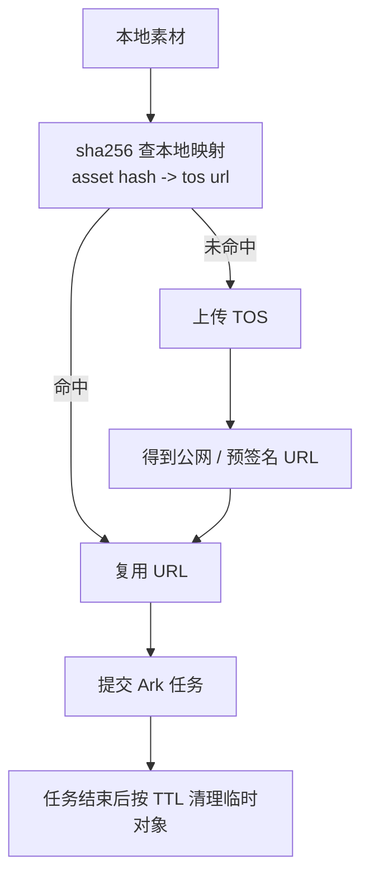

# Provider 适配层与火山引擎对接设计

> 状态：设计阶段，尚未实现
> 更新日期：2026-08-15

## 1. 目标

- 屏蔽不同第三方生成 API 的差异
- 统一文生图 / 图生图 / 图生视频的调用方式
- 先接入火山引擎，后续可扩展其他供应商
- 统一异步任务与轮询模型

## 2. 统一接口

```ts
interface GenerationProvider {
  id: string
  capabilities: {
    textToImage: boolean
    textToVideo: boolean
    imageToImage: boolean
    imageToVideo: boolean
    videoToVideo: boolean
  }
  textToImage(req: TextToImageRequest): Promise<GenerationJob>
  textToVideo(req: TextToVideoRequest): Promise<GenerationJob>
  imageToImage(req: ImageToImageRequest): Promise<GenerationJob>
  imageToVideo(req: ImageToVideoRequest): Promise<GenerationJob>
  videoToVideo(req: VideoToVideoRequest): Promise<GenerationJob>
  getJob(jobId: string): Promise<GenerationJob>
  cancelJob(jobId: string): Promise<void>
}
```

请求、响应、`GenerationJob`、`AssetRef` 定义见 `CORE_ENGINE_DESIGN.md`。

## 3. 火山引擎适配器

### 3.1 接口与产品线

- 接入面已确定：火山方舟 Ark API，OpenAI 兼容风格
- Base URL：`https://ark.cn-beijing.volces.com/api/v3`
- 认证：Bearer API Key（`ARK_API_KEY`），从控制台 API Key 页获取；非 AK/SK 签名
- 图像生成：豆包 Seedream 系列
- 视频生成：Seedance 系列
- 已从 Seedance 2.5 教程确认：视频走异步任务（创建任务 → 轮询状态 → 下载结果）

> 具体模型名、版本、端点以火山引擎官方文档为准，实现阶段最终确认。

### 3.2 图像生成映射（Seedream 5.0 Pro）

- 模型 ID：`doubao-seedream-5-0-pro-260628`
- 端点：`POST /api/v3/images/generations`
- 鉴权：`Authorization: Bearer <ARK_API_KEY>`
- 支持文生图、单/多图生图

请求字段：

- `model`
- `prompt`
- `image`：图生图输入，URL 或 base64，最多 10 张参考图
- `size`：`1K` / `1.5K` / `2K`，或 `宽x高`
- `output_format`：`png` / `jpeg`
- `response_format`：`url` / `b64_json`
- `watermark`：bool
- `background`：`transparent` / `opaque`
- `optimize_prompt_options.mode`：`standard` / `fast`

适配映射（L9）：

- 数值 `width × height` 映射到 `size`：
  - 先尝试命中 `1K / 1.5K / 2K` 的等比区间；无法精确命中时降级为 `宽x高`
  - 不支持的尺寸在适配层取整或直接报 `INVALID_PARAMS`，不静默改变用户意图
- `watermark`：用户生成内容默认 `false`；只有显式开启时才传 `true`

响应字段：

- `data[]`：`url`、`size`、`output_format` 等
- `usage`
- 图片 URL 有效期 24 小时

处理流程：

1. 调用生成
2. 拿到 URL 或 base64
3. 下载 / 解码到本地资产目录
4. 返回 `AssetRef`

### 3.3 视频生成映射（Seedance 2.5）

- 模型 ID：`doubao-seedance-2-5-260628`（或控制台配置的推理接入点 ID）
- 创建任务：`POST /api/v3/contents/generations/tasks`
- 查询任务：`GET /api/v3/contents/generations/tasks/{id}`
- 删除 / 取消任务：`DELETE /api/v3/contents/generations/tasks/{id}`
- 鉴权：`Authorization: Bearer <ARK_API_KEY>`
- 异步流程：
  1. 创建任务
  2. 获取 task id
  3. 轮询任务状态
  4. 完成后下载 `video_url` 到本地

请求字段：

- `model`
- `content[]`：
  - 文本：`{ type: "text", text: "..." }`
  - 图片：`{ type: "image_url", image_url: { url: "..." }, role: "reference_image" | "first_frame" | "last_frame" }`
  - 视频：`{ type: "video_url", video_url: { url: "..." }, role: "reference_video" }`
  - 音频：`{ type: "audio_url", audio_url: { url: "..." }, role: "reference_audio" }`
- `generate_audio`
- `ratio`：`16:9` / `4:3` / `1:1` / `3:4` / `9:16` / `21:9` / `adaptive`
- `duration`：4-30 秒，或 -1 自适应
- `resolution`：`480p` / `720p` / `1080p` / `4k`
- `output_format`：`mp4` / `mov`
- `watermark`：bool
- `omni_reference_task_type`：`auto` / `edit` / `extend`

视频编辑 / 延长（纳入 MVP）：`content[]` 提交 `video_url`，`omni_reference_task_type` 设为 `edit` / `extend`。
文本生视频（纳入 MVP）：`content[]` 仅提交 `text` 即可生成视频。
多模态参考：通过 `image_url` / `video_url` / `audio_url` 的 `role` 表达。

关键约束（编辑 / 延长 / 首帧首尾帧）：

- 输出视频的宽高比和时长以参考视频 / 首帧为基准锁定，`ratio` / `duration` 应使用 `adaptive`
- `output_format` 默认 `mp4`；`mov` 在 Windows 原生播放器可能不兼容

精确请求示例（30s 参考生视频，来自官方教程）：

```json
{
  "model": "doubao-seedance-2-5-260628",
  "content": [
    { "type": "text", "text": "..." },
    {
      "type": "image_url",
      "image_url": { "url": "https://..." },
      "role": "reference_image"
    }
  ],
  "generate_audio": true,
  "ratio": "16:9",
  "duration": 30
}
```

字段映射（内部类型 → Ark）：

- 内部 `durationMs` → Ark `duration`（秒，整数；自适应用 `-1`）
- 内部 `width / height / fps` → Ark `ratio` + `resolution`（精确映射表待补）
- `content[]` 的图片/视频/音频 URL 需公网可访问；本地文件先上传 TOS 换 URL（见 §9）

响应字段：

- `id`
- `status`：queued / running / cancelled / succeeded / failed / expired
- `content.video_url`
- `usage`
- `error.code` / `error.message`

视频 URL 有效期 24 小时，需及时下载到本地。

### 3.4 任务状态映射

火山引擎状态映射为统一 `GenerationStatus`：

```text
queued     -> pending
running    -> running
succeeded  -> succeeded
failed     -> failed
cancelled  -> cancelled
expired    -> failed（用独立错误码区分超时）
```

`cancelJob(jobId)` 通过火山方舟 `DELETE /contents/generations/tasks/{id}` 实现，
但该接口只支持取消 `queued`（排队中）任务：

- 对 `running` 任务：只能本地放弃，云端费用照扣，需在错误码与 UI 文案中明示
- 对已结束任务：仅删除本地记录，不改云端结果

父任务（画布渲染）取消时级联取消子任务：先对每个云端 `queued` 子任务发起 DELETE，
本地子任务统一置为 `cancelled`，再聚合父任务状态。

## 4. Job 轮询协议

引擎统一返回 `GenerationJob`，调用方轮询：

```text
generate ... -> { jobId }
job status <jobId> -> GenerationJob
job wait <jobId>   -> 阻塞直到终态
job cancel <jobId> -> 取消任务
```

轮询建议：

- 间隔从 1s 起，逐步退避到 5s-10s
- 超时上限可配置
- 任务状态持久化到 SQLite，支持重启恢复

## 5. 错误处理与重试

统一错误结构：

```ts
{
  code: string
  message: string
  retryable: boolean
}
```

重试策略：

- 网络错误、限流：指数退避重试
- 模型参数错误：不重试，直接失败
- 任务超时：标记失败，允许手动重试

## 6. 配置

```text
provider.volcengine.apiKey
provider.volcengine.baseUrl
provider.volcengine.imageModel
provider.volcengine.videoModel
provider.volcengine.timeoutMs
provider.volcengine.maxConcurrency = 3
```

## 7. 已确认

- Seedance 2.5 高级能力（多模态参考、视频编辑、视频延长）纳入 MVP

## 8. API Key 存储

- 由用户提供
- 保存在本地，使用系统 Keychain / 加密存储

## 9. 本地素材上传（TOS）

本地图片 / 视频 / 音频先上传到火山对象存储 TOS，拿到公网 URL 后再填入 Ark 的 `image_url.url` / `video_url.url` / `audio_url.url`。



设计要点：

- 抽象为 `AssetUploader` 接口，先实现 `TosUploader`，后续可替换其他对象存储
- SDK：使用 `@volcengine/tos-sdk`（Node.js，主进程侧）
  - 初始化：`new TosClient({ accessKeyId, accessKeySecret, region, endpoint })`
  - 上传：`putObject`；大文件走分片 / 断点续传
  - 预签名 URL：SDK 预签名机制，供 Ark 读取
  - 清理：`deleteObject`
- TOS 鉴权：MVP 用 AK/SK（`accessKeyId` / `accessKeySecret`，存 Keychain，不写项目文件）；STS 临时凭证后置
- URL 有效期：预签名 URL 需覆盖 Ark 排队 + 生成时间，默认建议 ≥ 2 小时
- 去重：按内容 sha256 复用已上传 URL，避免重复上传
- 清理：任务结束后删除临时对象；MVP 先按 TTL + 手动清理
- TOS 参数（bucket / region / endpoint / AK/SK / STS）由用户提供
- 参考文档：https://docs.volcengine.com/docs/6349/74837?lang=zh
