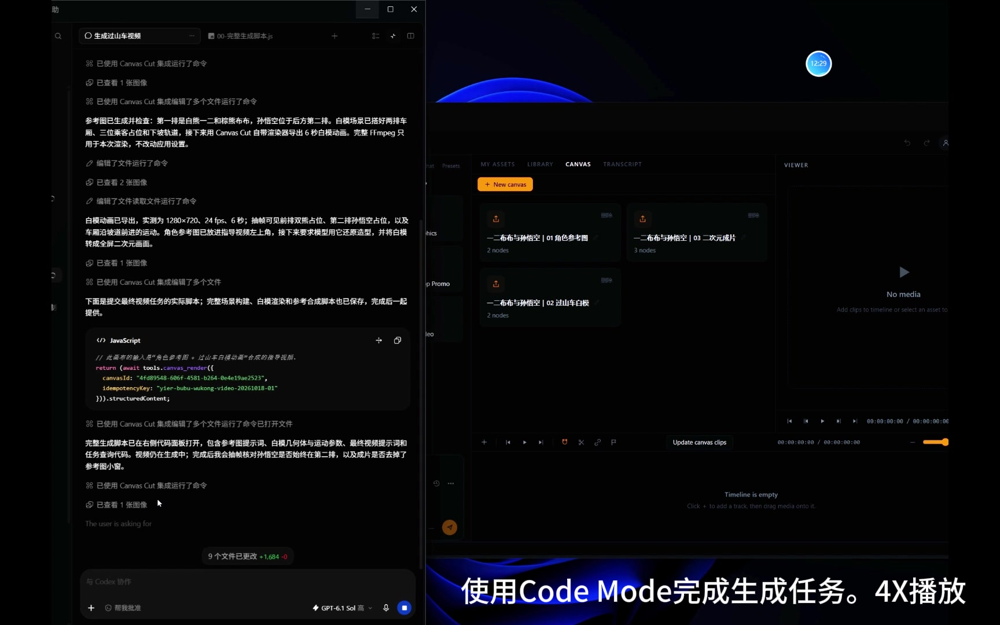

# Canvas Cut

Canvas Cut 是一个基于 Electron 的本地视频创作项目，使用节点画布组织图片与视频生成，通过时间线编排素材，并提供 CLI、内置 Agent 和外部 MCP Code Mode 三种自动化入口。

本 README 说明当前代码架构和实际使用方式。项目仍处于原型阶段；模型能力、生成质量和完整成片效果需要通过真实素材验证，自动化测试主要使用 mock Provider。

## 目录

- [示例](#示例)
- [快速启动](#快速启动)
- [代码架构](#代码架构)
- [项目数据与配置](#项目数据与配置)
- [配置 MCP 服务](#配置-mcp-服务)
- [使用 MCP Code Mode](#使用-mcp-code-mode)
- [生成任务与缓存语义](#生成任务与缓存语义)
- [内置 Agent 与 CLI](#内置-agent-与-cli)
- [验证与扩展](#验证与扩展)
- [常见问题](#常见问题)

## 示例

### 使用 Code Mode 搭建生成画布

以一二布布和孙悟空的过山车场景为例，展示通过 MCP Code Mode 搭建角色参考图、白模场景和视频生成画布的过程。

[](docs/examples/canvas-cut-demo-20261018.mp4)

[观看或下载示例视频](docs/examples/canvas-cut-demo-20261018.mp4) · 约 2 分 38 秒 · 1728 × 1080 · 4 倍速录屏

## 快速启动

### 环境要求

- Node.js 与 npm。根项目声明 Node.js >= 20，已使用 Node.js 22 验证。
- Windows 启动脚本使用 PowerShell。其他平台可构建后在 `apps/desktop` 下执行 `npm start`，平台行为仍需单独验收。
- 时间线导出需要可用的 FFmpeg、ffprobe，并具备所需编码器和滤镜；仅存在同名可执行文件不代表支持完整导出。

在仓库根目录执行：

```powershell
npm install
npm run build
npm run start:desktop
```

`npm install` 安装 npm workspaces；桌面包的 postinstall 使用 electron-rebuild 重建 better-sqlite3。`start:desktop` 默认再次构建并启动应用；已有构建时可使用 `npm run start:desktop -- -SkipBuild`。

首次使用可在桌面创建项目，也可通过 CLI 初始化一个新目录：

```powershell
node apps/cli/dist/index.js project init --project "C:/Projects/my-video" --name "My Video" --json
node apps/cli/dist/index.js project status --project "C:/Projects/my-video" --json
```

在桌面设置中配置生成服务的 ARK 密钥；需要把本地参考图上传给视频模型时，还需配置 TOS 凭证、bucket、region 和 endpoint。模型地址、图片/视频模型等项目配置保存在项目的 `config.json`。

画布生成需要桌面主进程运行。直接使用 Code Mode 画布工具无需配置内置 Agent 的聊天模型；调用 `agent_send_prompt` 开始模型对话时，需另配 Agent 地址、模型和密钥。

每个云端生成节点可单独设置模型：展开节点，在「生成模型」下拉框选择型号，或选择「自定义模型 ID / 接入点 ID」后输入并保存。选择「使用项目默认」或留空会沿用 Settings 中的图像/视频模型；不同节点可以混用，节点底部显示实际选择。下拉列表按节点生成方式筛选，使用官方目录快照，账号是否已开通未自动查询；目录范围与维护入口见[Provider](Reference/modules/core-provider.md)。CLI/MCP 对应参数仍为 `params.model`，清空用 `""` 或 `null`；更换实际模型后缓存会区分，详见[画布模型与缓存](Reference/modules/core-canvas.md)。模型仍需支持该节点的生成方式。

画布支持重命名：在列表卡片或画布顶部双击名称，或点击旁边的铅笔；Enter/勾选保存，Esc/取消放弃。名称保存在项目中，旧画布仍可显示 Canvas 序号；改名不会使生成缓存或时间线素材过期。CLI 使用 `canvas-cut canvas rename <canvasId> --name "广州塔" --json`；MCP 在 execute 内调用 `await tools.canvas_rename({canvasId, name: "广州塔"})`，可在创建画布时传入 name。规则与接口见[画布](Reference/modules/core-canvas.md)。

## 代码架构

技术栈、包依赖与主要调用链见 [AGENTS.md](AGENTS.md)；完整模块职责、接口与边界见 [Reference](Reference/README.md)。当前是 Electron/React 桌面应用，CLI、内置 Agent 和 MCP 共享业务能力；长任务需要桌面主进程运行。实际职责重叠和未实现设计已记录在 [架构问题](Reference/issues.md)，不改变现有运行行为。

### 白模视频使用

打开画布后，在空白处右键选择要添加的节点，新节点落在点击的位置；工具栏的节点下拉框也保留。菜单交互和验证说明见 [桌面 UI](Reference/modules/desktop-ui.md)。

拖近同类型节点，出现高亮、虚线对齐引导线和落点轮廓后松开即可吸附对齐；画布右上角可关闭吸附。Shift/Ctrl 多选或拖动框选后，点击「打组」或按 Ctrl+G，拖动组标题即可整体移动，名称可直接编辑；解组使用按钮或 Ctrl+Shift+G。左键空白处框选，中键或按住空格拖动画布。位置和分组保存在本设备的应用存储中，重新打开同一项目和画布会恢复；存储边界见 [桌面 UI](Reference/modules/desktop-ui.md)。

在节点菜单添加 white-model-video，展开参数面板后添加方块、球体或圆柱，调整物体与相机的起止参数，预览并保存。把 video 输出连接到 output，点击生成得到本地 MP4，也可接入 video-to-video 或加入时间线。

该节点不需要 ARK/TOS 密钥，连接下游 AI 节点仍需对应配置。Settings 中应选择支持 image2、PNG 解码和 libx264 的完整 FFmpeg。默认场景和限制见 [画布参数契约](Reference/modules/core-canvas.md)，输出/进度/取消见 [任务说明](Reference/modules/desktop-jobs.md)，真实 Electron 验收脚本见 [工程说明](Reference/modules/engineering.md)。

### 开发文档

- [画布编辑与执行](Reference/modules/core-canvas.md)、[时间线与计划](Reference/modules/core-timeline.md)
- [桌面桥接](Reference/modules/desktop-bridge.md)、[CLI](Reference/modules/cli.md)、[对外 MCP](Reference/modules/cli-mcp.md)
- [Agent Runtime](Reference/modules/agent-runtime.md)、[宿主](Reference/modules/desktop-agent-host.md)、[Code Mode](Reference/modules/codemode.md)

## 项目数据与配置

典型项目目录如下：

```text
my-video/
├── project.json          # 项目 ID、名称、默认分辨率和帧率
├── config.json           # Provider、TOS、并发和 FFmpeg 项目配置
├── canvases/
│   └── <canvasId>.json    # 节点、参数、端口、连线、版本与 graphHash
├── timeline/
│   └── timeline.json     # 轨道、媒体/画布引用、裁剪与效果
├── assets/               # 导入及生成的图片、视频和音频
├── cache/
│   └── nodes.json        # 节点生成缓存；必要时还有 jobs.json
├── presets/              # 保存的画布预设
├── jobs.sqlite           # 异步任务数据库，按需创建
└── skills/               # 可选的项目 Skills
```

桌面运行时设置、IPC 实例信息和 Agent 会话保存在 Electron userData。敏感设置通过 Electron safeStorage 加密，不应把密钥或运行时凭证提交到项目仓库。生成 Worker 从桌面进程读取 ARK 和 TOS 凭证，因此只给 MCP 子进程配置密钥不能代替桌面配置。

跨电脑迁移模型 API 配置：打开设置，点击「导出配置」，把 JSON 复制到新电脑，在设置中点击「导入配置」，检查表单后点击「保存」。导出当前表单中的 ARK/Agent 地址、模型及 TOS 配置，默认不含凭证；需要连同密钥迁移时勾选「包含 API 密钥（明文）」，妥善保管该文件，新电脑保存后会重新进行系统加密。未包含的字段保留原值。FFmpeg 路径、Runtime/Langfuse/MCP、项目内容和节点模型覆盖不包含在文件中；格式与边界见[桌面设置](Reference/modules/desktop-shell.md)。

FFmpeg 与 ffprobe 可以加入 PATH，也可在桌面设置填写 FFmpeg 可执行文件的完整路径，并将 ffprobe 放在同目录；支持 `FFMPEG_PATH` / `FFPROBE_PATH` 环境变量。画布修改后需要重新生成；时间线引用可通过桌面更新操作或 CLI `timeline refresh-canvases` 更新，更新会保留已有裁剪长度。

## 配置 MCP 服务

先构建 CLI 并启动桌面：

```powershell
npm run build:cli
npm run start:desktop
```

在 MCP 客户端中添加 stdio 服务。下面是常见的 JSON 配置结构；把 Node、CLI 入口和项目目录替换为本机实际的绝对路径：

```json
{
  "mcpServers": {
    "canvas-cut": {
      "command": "C:/Program Files/nodejs/node.exe",
      "args": [
        "C:/path/to/canvas_cut/apps/cli/dist/index.js",
        "mcp",
        "--project",
        "C:/Projects/my-video"
      ]
    }
  }
}
```

客户端也可以直接启动 `node <CLI绝对路径> mcp --project <项目绝对路径>`。这是长期运行的 stdio 服务，应由 MCP 客户端维持 stdin/stdout；不是执行一次就输出所有画布的普通 CLI 命令。

`projectPath` 默认取 MCP 启动时的 `--project`，不会跟随桌面当前项目变化。内部项目工具可传 `projectPath` 覆盖默认值；`canvas_node_types` 不需要项目，但仍通过桌面 IPC 调用。修改代码或工具说明后，重新构建并重连 MCP，让客户端刷新缓存的工具列表和 `initialize.instructions`。

### 对外工具与内部目录

`tools/list` 对外暴露 7 个工具：

| 工具 | 用途 |
| --- | --- |
| `search_tools` | 发现可在 Code Mode 中调用的内部工具 |
| `execute` | 执行 JavaScript，编排注册工具 |
| `agent_send_prompt` | 向桌面 Agent 会话提交 prompt，立即返回 runId |
| `agent_get_run` | 查询会话最新运行及游标后的增量事件 |
| `agent_history` | 读取会话消息、工具历史与最新运行 |
| `agent_cancel` | 停止会话当前 Agent 运行 |
| `ui_screenshot` | 获取桌面窗口截图；fresh=false 读取最近保存截图 |

四个 `agent_*` 工具支持可选 `projectPath`、`conversationId`，默认会话 ID 为 `default`；`agent_get_run` 还支持 `after` 游标。`runId` 用于核对身份，不是查询任意历史运行的参数。

画布和任务方法只注册在 Code Mode 内部目录，必须在 `execute` 中写 `tools.canvas_create(...)` 等。不要发送顶层 `tools/call` 的 `name: "canvas_create"`，也不需要为原生画布操作启动另一轮内置 Agent。

## 使用 MCP Code Mode

### 1. 发现工具

客户端调用 `search_tools`，参数例如：

```json
{ "query": "canvas", "offset": 0, "limit": 20 }
```

搜索匹配工具名称和描述，空格分隔的词必须全部匹配；空 `query` 列出所有内部工具。默认 `limit` 为 10，上限 20，通过返回的 `nextOffset` 分页。

返回值在 `content[0].text` 中，是 JSON，包含 `total`、`nextOffset`、`tools`。每个工具条目提供 `name`、`description`、`inputSchema`、`outputSchema`（存在时）、`declaration` 和 `resultType`。TypeScript 声明用于指导模型写代码，实际 `execute` 不支持 TypeScript 语法。

### 2. 编写并执行 JavaScript

`execute` 的参数是 `{ "code": "..." }`，code 为异步函数体，直接使用顶层 `await` 和 `return`，不要加外层函数声明或 TypeScript 类型。最小只读调用：

```json
{
  "code": "const { canvases } = (await tools.canvas_list({})).structuredContent; return { count: canvases.length, canvases };"
}
```

除 SDK 客户端示例外，下文的 JavaScript 代码块都应作为 `code` 字符串提交，不是在宿主 Node.js 中直接运行。支持循环、`Promise.all`、`try/catch` 和 `console.log`；依赖上一步返回值的创建、连线与生成操作应顺序执行。

两层返回值需要分别处理：

| 所在位置 | 读取方式 |
| --- | --- |
| Code Mode 内部的画布/任务工具结果 | `(await tools.canvas_get(...)).structuredContent` |
| Code Mode 内部的旧 Agent 工具结果 | `JSON.parse((await tools.agent_history(...)).content[0].text)` |
| 客户端收到的 execute 结果 | 先检查 `response.isError`，再读取 `JSON.parse(response.content[0].text)`，其字段为 `{ result, logs, calls }` |

内部工具返回 isError 时会转成可捕获的异常。每次执行都是新运行时，变量和 globalThis 不会跨调用保留；客户端应保存返回的 canvasId、nodeId、edgeId 和 jobId，并在后续代码中再次传入。

### 3. 查询节点和参数

添加节点前先执行：

```javascript
return (await tools.canvas_node_types({})).structuredContent;
```

目前包含 10 类节点，端口 ID 区分大小写：

| 类型 | 输入端口 | 输出端口 | 参数示例 |
| --- | --- | --- | --- |
| `text-input` | 无 | `text` | `{ text: "中文提示词" }` |
| `image-input` | 无 | `image` | `{ asset: AssetRef }` |
| `video-input` | 无 | `video` | `{ asset: AssetRef }` |
| `canvas-reference` | 无 | `video` | `{ canvasId: "其他画布ID" }` |
| `text-to-image` | `text` | `image` | `{ prompt: "后备提示词", sizeMode: "2K" }` |
| `text-to-video` | `text` | `video` | `{ durationMs: 4000, width: 1920, height: 1080 }` |
| `image-to-image` | `image`、`text` | `image` | `{ prompt: "修改画面", strength: 0.5 }` |
| `image-to-video` | `image`、`text` | `video` | `{ prompt: "镜头运动", durationMs: 4000 }` |
| `video-to-video` | `video`、`text` | `video` | `{ prompt: "修改视频", mode: "edit" }` |
| `output` | `image`、`video` | `image`、`video` | `{}` |

必需输入也可以由非空 `params.prompt` 或对应 `params.asset` 满足。非空的已连接文本优先于生成节点的 prompt，因此有文本输入连线时应修改输入节点的 `params.text`。连线两端媒体类型必须一致，已占用的输入端口会拒绝重复连接。

目录中的 `paramsSchema`、`requiredInputPorts`、`exampleParams` 和 `notes` 描述结构约束，不代表已配置 Provider/模型支持每个参数值。

### 4. 创建、修改画布并提交图片任务

下面创建“文本 → 文生图 → 输出”画布，修改文本，重读确认中文一致，再提交生成：

```javascript
const data = r => r.structuredContent;
const { canvasId } = data(await tools.canvas_create({}));
const input = data(await tools.canvas_node_add({
  canvasId, type: "text-input", params: { text: "一只狸花猫坐在窗边，写实摄影" }
}));
const image = data(await tools.canvas_node_add({
  canvasId, type: "text-to-image", params: { sizeMode: "2K", watermark: false }
}));
const output = data(await tools.canvas_node_add({ canvasId, type: "output" }));
await tools.canvas_edge_connect({
  canvasId, source: input.nodeId, sourcePort: "text", target: image.nodeId, targetPort: "text"
});
await tools.canvas_edge_connect({
  canvasId, source: image.nodeId, sourcePort: "image", target: output.nodeId, targetPort: "image"
});
const text = "16:9横向构图，一只中国狸花猫坐在窗边，绿色眼睛，虎斑清晰，柔和晨光，写实摄影，无文字";
await tools.canvas_node_set_params({ canvasId, nodeId: input.nodeId, params: { text } });
const saved = data(await tools.canvas_get({ canvasId }));
if (saved.nodes.find(n => n.id === input.nodeId).params.text !== text) {
  throw new Error("提示词写入校验失败，停止生成");
}
const job = data(await tools.canvas_render({
  canvasId, idempotencyKey: `image-v1-${canvasId}`
}));
return {
  canvasId, inputNodeId: input.nodeId, imageNodeId: image.nodeId,
  outputNodeId: output.nodeId, imageJobId: job.jobId
};
```

所有项目方法都支持可选 `projectPath`，默认使用启动配置。编辑接口及结果如下：

| 方法 | 主要参数 | structuredContent 结果 |
| --- | --- | --- |
| `canvas_list` | 无必填参数 | `{ canvases }`，列表项含 canvasId、version、nodeCount |
| `canvas_get` | canvasId | 完整画布对象，包含 nodes、edges、version、graphHash |
| `canvas_create` | 无必填参数 | `{ canvasId, version, canvas }` |
| `canvas_node_add` | canvasId、type、可选 params | `{ nodeId, version, node }` |
| `canvas_node_set_params` | canvasId、nodeId、params | `{ nodeId, version, node }`，参数合并更新 |
| `canvas_node_remove` | canvasId、nodeId | `{ removed, version }`，同时删除关联边 |
| `canvas_edge_connect` | canvasId、source、sourcePort、target、targetPort | `{ edgeId, version, edge }` |
| `canvas_edge_remove` | canvasId、edgeId | `{ removed, version }` |
| `canvas_render` | canvasId、可选 nodeId/force/idempotencyKey | `{ jobId, type, childJobIds? }` |
| `job_status` | jobId | 状态、进度、结果、错误及子任务 |
| `job_cancel` | jobId | `{ cancelled }` |

`canvas_create` 创建空画布，不初始化项目，也不切换桌面到新画布。编辑参数保留未指定字段，更新版本并使相关缓存失效，不自动生成。

### 5. 查询或取消生成任务

在后续 execute 中，把 JOB_ID 替换为上一步返回的真实 jobId：

```javascript
return (await tools.job_status({ jobId: "JOB_ID" })).structuredContent;
```

状态为 `pending`、`running`、`succeeded`、`failed` 或 `cancelled`。客户端在多次独立 execute 调用之间等待；不要在同一个脚本中长时间轮询。需要取消时单独执行：

```javascript
return (await tools.job_cancel({ jobId: "JOB_ID" })).structuredContent;
```

父任务 succeeded 表示整图完成。父任务失败时也应检查 `children`：例如图片已经成功而视频失败，参考图仍可能位于子任务的 `result.path`，但未必已写回画布节点。

AssetRef 是文件引用，通常含 `{ id, path, type, sizeBytes }`，时长和尺寸字段不一定存在。应使用宿主媒体工具查看实际主体，并用 ffprobe 等检查时长、尺寸；成功状态本身不保证生成内容符合提示词。

### 6. 先检查参考图，再生成视频

如果只要求顺序生成，可一次创建“文生图 → 图生视频 → output”图，Worker 会按依赖自动执行，中间不会暂停。

如果需要先检查参考图，先完成上面的图片画布并查看结果，再添加视频节点。把下面 ID 替换为客户端保存的真实值；不要提前创建一个断开的视频生成节点，因为整图执行也会运行它。

```javascript
const canvasId = "CANVAS_ID";
const imageNodeId = "IMAGE_NODE_ID";
const outputNodeId = "OUTPUT_NODE_ID";
const graph = (await tools.canvas_get({ canvasId })).structuredContent;
const oldOutputEdge = graph.edges.find(e => e.target === outputNodeId);
if (!oldOutputEdge || oldOutputEdge.source !== imageNodeId) {
  throw new Error("当前画布不是预期的图片输出，请先检查画布");
}
const video = (await tools.canvas_node_add({
  canvasId, type: "image-to-video",
  params: {
    prompt: "保持参考图中的狸花猫和场景一致，轻轻转头，自然眨眼，固定机位，无文字",
    durationMs: 4000, width: 1920, height: 1080
  }
})).structuredContent;
await tools.canvas_edge_connect({
  canvasId, source: imageNodeId, sourcePort: "image", target: video.nodeId, targetPort: "image"
});
await tools.canvas_edge_remove({ canvasId, edgeId: oldOutputEdge.id });
await tools.canvas_edge_connect({
  canvasId, source: video.nodeId, sourcePort: "video", target: outputNodeId, targetPort: "video"
});
const job = (await tools.canvas_render({
  canvasId, idempotencyKey: `video-v1-${canvasId}`
})).structuredContent;
return { canvasId, videoNodeId: video.nodeId, videoJobId: job.jobId };
```

保持原图片节点、提示词及项目设置不变时，参考图通常会命中缓存；此处省略 nodeId 和 force，避免强制重新生成参考图。

### 7. 用 MCP SDK 接入

下面是宿主 Node.js 客户端示例，应保存为 `.mjs` 并在安装了 `@modelcontextprotocol/sdk` 的环境执行。它通过 SDK 自动完成协议初始化，仅查询画布数量；与上面的 Code Mode 函数体示例不同，它运行在客户端进程中。

```javascript
import { Client } from "@modelcontextprotocol/sdk/client/index.js";
import { StdioClientTransport } from "@modelcontextprotocol/sdk/client/stdio.js";

const client = new Client({ name: "canvas-cut-client", version: "1.0.0" });
const transport = new StdioClientTransport({
  command: process.execPath,
  args: ["C:/path/to/canvas_cut/apps/cli/dist/index.js", "mcp", "--project", "C:/Projects/my-video"]
});
try {
  await client.connect(transport);
  const discovery = await client.callTool({ name: "search_tools", arguments: { query: "canvas_list" } });
  if (discovery.isError) throw new Error(discovery.content[0].text);
  console.log(JSON.parse(discovery.content[0].text));
  const response = await client.callTool({
    name: "execute",
    arguments: { code: "const { canvases } = (await tools.canvas_list({})).structuredContent; return { count: canvases.length, canvases };" }
  });
  if (response.isError) throw new Error(response.content[0].text);
  console.log(JSON.parse(response.content[0].text).result);
} finally {
  await client.close();
}
```

## 生成任务与缓存语义

| 行为 | 实际语义 |
| --- | --- |
| `canvas_render({ canvasId })` | 验证并执行整张图，正常复用缓存；返回任务 ID，不等待生成完成 |
| `canvas_render({ canvasId, nodeId })` | 强制重算该节点及其下游；仍执行整图，不是单节点目标，也不会在该节点停止 |
| `canvas_render({ canvasId, force: true })` | 绕过所有生成节点缓存，可能重复调用图片和视频 Provider |
| 复用 idempotencyKey | 用于同一次提交的不确定重试；返回原任务，包括已成功/失败任务 |
| 编辑提示词后再生成 | 使用新幂等键；编辑图本身不会使旧键变成新提交 |
| 同一个 key 改变 render 参数 | 可能报幂等冲突，不能作为新的生成请求 |
| 多次工具调用中途失败 | 之前成功的修改保留；整段脚本不是事务 |
| execute 超时/取消或 MCP 断开 | 已派发编辑可能完成，已提交生成继续运行；查询状态后用 job_cancel 明确取消 |

`durationMs` 单位是毫秒，4000 表示请求 4 秒。当前视频适配器转换为整秒；模型及生成模式可能拒绝通过 Schema 校验的时长。一次实际 Seedance 2.5 参考图视频调用拒绝 3 秒、接受 4 秒，这只是该次配置的观察，不是所有模型的能力承诺。

视频宽高会映射为 Provider 支持的比例和分辨率档位，帧率等请求值也未必被支持；图片的 sizeMode 或项目 imageResolution 可以优先于自定义宽高。请求 16:9 可使用 1920×1080 的视频参数，同时在图片提示词中明确横向构图，最后检查实际结果。

需要精确 3 秒成片时，应请求模型支持的时长，再通过宿主工具或时间线导出裁剪。本 Code Mode 内部目录目前没有时间线编辑、画布整体删除、素材导入、裁剪或导出方法；CLI/桌面具备的能力不会自动出现在 tools 中。

### 执行限制

| 限制 | 默认值 |
| --- | --- |
| 单次 execute 时限 | 30 秒 |
| QuickJS 堆内存 | 32 MiB |
| 单次工具调用次数 | 32 |
| 返回内容大小 | 1 MiB |
| JavaScript 源码 | 64 KiB |
| 同时执行数 | 4 |
| console.log 累计大小 | 64 KiB |
| 工具返回消息桥累计大小 | 4 MiB |

JavaScript 不提供 process、require、fetch、文件系统、模块导入或定时器。Code Mode 的隔离只约束脚本自身；调用 agent_send_prompt 仍会启动有本地文件和 Shell 能力的桌面 Agent。

## 内置 Agent 与 CLI

桌面 Agent 使用 AI SDK 进行单步流式模型调用，注册文件、补丁、Shell/PTY、Skills 和外部 MCP 工具；由桌面宿主提供模型配置、项目 cwd、应用说明和 canvas-cut CLI launcher。每个会话只允许一个活动运行，会话消息、工具记录和游标保存在 userData 的 `agent/sessions`，重启后保留历史并标记中断运行。

DeepSeek 官方端点或名称含 DeepSeek 前缀的模型会自动使用对应 Chat 适配器，保留 `reasoning_content` 并在工具后续请求和重开会话后回传，避免思考模式报缺少字段。自定义代理继续使用配置的地址和密钥；识别范围、旧会话缺失内容的限制及验证方式见[Agent Runtime](Reference/modules/agent-runtime.md)。

Skills 的覆盖优先级为项目 > 用户 > 内置：项目 `<project>/skills`，用户 `~/.canvas-cut/skills`，内置仓库 `skills`。运行时按需发现和加载说明。当前为本地可信执行模式，项目 cwd 不是文件系统沙箱。

停止 Agent 会停止该 run 的模型调用及所属本地进程，不自动取消已提交的生成任务。外部 Agent 也可以直接使用 Code Mode，无需经过内置 Agent 的模型循环。

CLI 的主要命令族包括 project、canvas、generate、job、timeline、asset、preset。查看实际命令和参数：

```powershell
node apps/cli/dist/index.js --help
node apps/cli/dist/index.js manifest --json
node apps/cli/dist/index.js canvas render --help
```

CLI 的项目/画布文件操作可直接使用 core，生成、任务查询和导出通过桌面 IPC。`--json` 便于解析结果；支持 dry-run 的生成、画布渲染和导出命令可用 `--dry-run` 验证请求，其他命令不支持该选项。

## 验证与扩展

构建、开发启动、按模块选择测试及白模实机脚本见 [工程说明](Reference/modules/engineering.md)。npm run dev:desktop:app 启动完整开发桌面，默认自动选择端口；可传 -SkipBuild 或 -Port。构建不生成安装包，mock 模型/Provider 回归不等于真实创作质量验收。

新增能力先在 [Reference 索引](Reference/README.md)确定唯一模块归属，同步所属模块的接口、边界与验证入口。新增画布节点/工具维护 core registry/api/engine，再由对应桌面服务和 MCP 桥消费；新增 Provider 实现 GenerationProvider 并接入 factory，具体约束见对应模块。

- [产品范围与创作验收](Reference/product.md)
- [问题记录](Reference/issues.md)与[必要历史决策](Reference/decisions.md)
- [旧文档迁移对照](Reference/migration.md)
- [当前计划与历史验证](PLAN.md)

本次文档治理没有重新运行业务测试或调用真实生成服务。当前可调用工具及 Schema 以运行服务的发现结果为准。

## 常见问题

| 现象 | 排查方式 |
| --- | --- |
| `Unknown tool: canvas_create` | 这是内部方法，应调用 execute，代码中写 tools.canvas_create |
| 客户端只显示旧工具或旧说明 | 确认 CLI dist 已重新构建，重启/重连 MCP 服务，刷新工具缓存 |
| `Electron main process is not running` | 确认桌面已启动，MCP 与桌面属于同一用户环境，且可访问 userData 的 IPC 实例文件 |
| 查到的画布不是桌面当前项目 | 检查 MCP --project；它不跟随桌面项目切换，必要时显式传 projectPath |
| 中文变成 `????` | 检查客户端 stdin 编码；进入 MCP 前已丢失的字符无法恢复，应恢复原文再提交 |
| `InvalidParameter` 时长/尺寸错误 | 读取 job_status.error，使用模型支持的参数，修正后用新幂等键提交 |
| 视频模型拒绝本地参考图 | 检查桌面 TOS 上传配置和凭证；本地文件需要上传后才能交给 Provider |
| 改了生成节点 prompt 却没改变内容 | 查看是否有非空文本输入连线；它优先于 prompt，应修改该输入节点的 params.text |
| 修改提示词后返回旧任务 | 检查是否复用旧幂等键；新生成需新键 |
| 图片成功但视频失败 | 查看 job_status.children 的图片结果与视频 error，保留成功素材后修正失败阶段 |
| 执行超时后不确定是否生成 | 先按已返回 jobId 查询任务，或重读画布；有稳定键时只重试同一次提交 |

手写 PowerShell/.NET stdio 客户端必须在启动子进程前设置重定向流为 UTF-8、无 BOM，每行发送一个 JSON-RPC 消息。仅设置控制台编码或 `$OutputEncoding` 不会设置 Process.StandardInput 的编码：

```powershell
$utf8 = [System.Text.UTF8Encoding]::new($false)
$startInfo.StandardInputEncoding = $utf8
$startInfo.StandardOutputEncoding = $utf8
$startInfo.StandardErrorEncoding = $utf8
```

优先使用 MCP SDK transport，发送中文后用 canvas_get 重读比对。stdout 用于 JSON-RPC，诊断应写 stderr，避免额外文本破坏协议。
