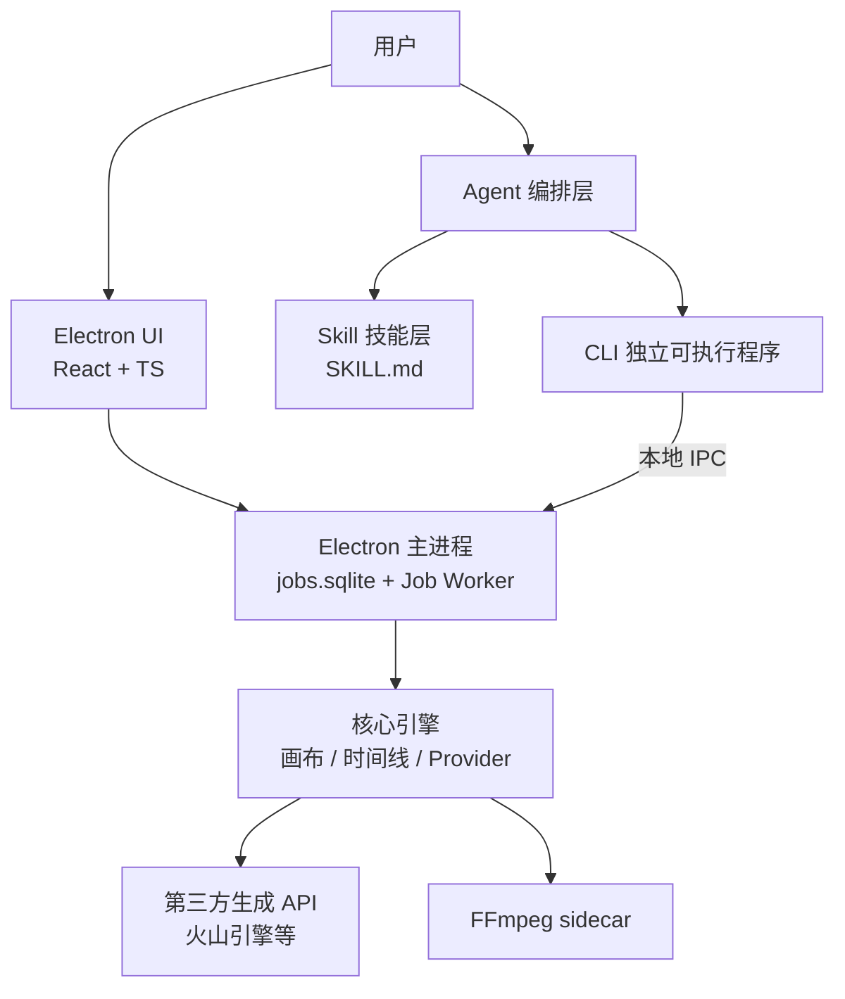

# 技术方案文档（TECH DESIGN）

> 状态：规划中，尚未实现
> 更新日期：2026-08-15

本文档汇总当前已确认的技术方案，并列出仍需补充的设计缺口。

## 1. 当前技术方案总览

| 领域 | 当前决定 |
| --- | --- |
| 桌面壳 | Electron（验证阶段） |
| UI | React + TypeScript + Vite |
| 节点图 | React Flow |
| 时间线 | 自研轻量版 |
| 核心引擎语言 | TypeScript，框架无关 |
| 导出 | FFmpeg sidecar |
| Agent | Mastra（底层 Vercel AI SDK），TypeScript |
| 本地存储 | SQLite（better-sqlite3，主进程独占）+ 文件系统 |
| 第三方 API | 火山引擎多模态 API 优先，统一 Provider 适配层 |
| 能力暴露 | 独立可执行 CLI（生成/渲染需桌面端运行） |
| 技能封装 | SKILL.md |
| 稳定阶段媒体核心 | 迁移到 C++，硬件加速编解码 |
| 稳定阶段桌面壳 | MVP 完成后切换 Qt 等原生方案 |

## 2. 架构总览

## 3. 已确定的技术细节

### 3.1 桌面壳与 UI

- 验证阶段：Electron + React + TypeScript + Vite
- 节点图使用 React Flow
- 时间线自研轻量版
- MVP 完成后切换 Qt 等原生方案

### 3.2 CLI

- 独立可执行程序
- Agent 与高级用户共用同一套 CLI
- 统一支持 `--json`、`--dry-run`、稳定错误码
- 命令分类：
  - `project init` / `open` / `status`
  - `generate text-to-image` / `image-to-image` / `image-to-video`
  - `canvas create` / `node add` / `edge connect` / `render`
  - `timeline add-clip` / `add-subtitle` / `add-audio` / `export`
  - `preset save` / `list` / `apply`

### 3.3 Skill

- 使用 SKILL.md 格式
- 描述名称、用途、输入、输出、执行步骤
- 步骤对应 CLI 命令

### 3.4 Agent

- Mastra（底层 Vercel AI SDK），TypeScript 实现
- 理解用户意图，匹配 Skill，填充参数，调用 CLI
- 支持失败重试、多步状态、技能组合

### 3.5 核心引擎

- 画布引擎：节点 DAG、异步生成任务、结果缓存、版本管理
- 时间线编辑器：多轨道数据、剪辑操作、画布片段引用
- Provider 适配层：统一文生图 / 图生图 / 图生视频调用

### 3.6 渲染与预览

- 预览：WebGL 实时合成 + 本地低清代理（画布按导出分辨率一次生成）
- 导出：FFmpeg sidecar
- 稳定阶段：C++ 媒体核心 + 硬件加速

### 3.7 存储

- 项目元数据 / 任务：SQLite（better-sqlite3，主进程独占）
- 项目结构数据：JSON 文件（原子写 + `.lock`）
- 媒体资产与生成结果：文件系统

## 4. 待补充 / 缺口清单

### P0：核心引擎必须补全

1. Provider 接口精确 schema
   - 文生图 / 图生图 / 图生视频的请求、响应结构
   - 异步任务轮询、进度、错误码
   - 火山引擎具体接口与模型确认

2. 画布节点引擎
   - 节点 DAG 数据结构与 schema
   - 节点端口、参数 schema、边
   - 拓扑排序、执行调度、缓存键、增量更新
   - 任务状态机：pending / running / succeeded / failed / cancelled
   - 进度上报、超时、取消、重试

3. 时间线数据模型
   - Track / Clip 详细 schema
   - 剪辑操作 API
   - 渲染计划生成

### P0：CLI 必须补全

4. CLI 运行时与打包方式
   - Node / Bun / Rust 的选择与产物形态
   - 独立可执行文件的构建方式

5. CLI 完整命令树与参数 schema
   - 每个命令的参数、默认值、校验规则
   - JSON 输出 schema
   - 错误码表

6. 项目状态文件协议
   - 项目文件结构
   - 并发访问与锁

7. CLI 与 Electron 的通信（已设计，见 CLI_DESIGN.md）
   - 短命令：主进程代理 spawn CLI；长任务：UI 直连主进程内部 API，不 spawn CLI
   - 外部 CLI 通过本地 IPC 投递；主进程唯一拥有 jobs.sqlite 与 Job Worker

### P0：Skill 必须补全

8. SKILL.md 规范
   - frontmatter 字段：name / description / inputs / outputs / version
   - 步骤如何映射到 CLI 命令
   - 条件、循环、错误处理表达方式

9. 技能加载与参数绑定
   - 技能发现与加载机制
   - 用户自定义技能机制

### P0：Agent 必须补全

10. Agent 框架最终选型（已确定：Mastra）
    - CLI 命令注册为工具的方式（以 CLI manifest 自动生成为准）

11. Agent 执行流程
    - 规划 / 执行循环
    - 是否引入 human-in-the-loop 审批
    - 流式输出与上下文管理
    - 多步任务状态持久化

### P1：渲染与预览

12. MVP 预览具体实现（已确定：WebGL 实时合成 + 本地低清代理）
    - 逐帧拖动方案

13. 多轨道渲染计划
    - FFmpeg filter graph 分段渲染
    - 段落缓存

14. 预览与导出一致性
    - WebGL 预览与 FFmpeg 导出的效果差异控制

### P1：数据与存储

15. 项目目录结构
    - 项目文件、画布 JSON、时间线 JSON、资产目录

16. 自动保存与版本迁移

### P1：安全

17. API Key 存储
    - 火山引擎密钥是否用户提供
    - 使用系统 Keychain 保存

18. Prompt 注入与内容安全

### P2：工程化与分发

19. 代码仓库结构
    - 是否 monorepo
    - CLI、核心引擎、UI、Skill 的目录划分

20. 测试策略
    - CLI / 引擎 / Agent 的单元与集成测试

21. 打包与自动更新
    - Electron 打包
    - CLI 打包
    - 应用分发与更新

### 开放决策

22. 目标平台：先 Windows，还是 Windows + macOS
23. 商业模式：用户自带 API Key，还是后端统一代理

## 5. 当前设计状态

### 已完成设计

| 缺口 | 状态 | 文档 |
| --- | --- | --- |
| Provider 接口 schema | 已设计 | PROVIDER_ADAPTER_DESIGN.md |
| 画布节点引擎 | 已设计 | CORE_ENGINE_DESIGN.md |
| 时间线数据模型 | 已设计 | CORE_ENGINE_DESIGN.md |
| CLI 命令树与参数 | 已设计 | CLI_DESIGN.md |
| CLI 与 Electron 通信 | 已设计 | CLI_DESIGN.md |
| SKILL.md 规范 | 已设计 | AGENT_ORCHESTRATION_DESIGN.md |
| Agent 执行流程 | 已设计 | AGENT_ORCHESTRATION_DESIGN.md |
| 多轨道渲染计划 | 已设计 | TIMELINE_RENDER_DESIGN.md |

### 待设计 / 待确认

| 缺口 | 状态 |
| --- | --- |
| CLI 运行时与打包方式 | 已确定：Node.js + esbuild + pkg/SEA |
| 项目状态文件协议 | 已设计，见 PROJECT_STATE_PROTOCOL.md |
| 技能加载与参数绑定 | 已设计：LLM 直接选择 + skills 工具 |
| Agent 框架最终选型 | 已确定：Mastra |
| Agent 具体工具列表 | 已设计，见 AGENT_ORCHESTRATION_DESIGN.md |
| MVP 预览具体实现 | 已确定：WebGL 实时合成 + 本地低清代理 |
| 预览与导出一致性 | 已决策方向：一次生成 + 本地代理；特效/贴纸双后端一致性待设计 |
| 项目目录结构细节 | 部分设计 |
| 自动保存与版本迁移 | 待设计 |
| API Key 存储 | 已确定：用户提供，本地 Keychain |
| Prompt 注入与内容安全 | 待设计 |
| 代码仓库结构 | 已设计：monorepo，见 REPO_STRUCTURE.md |
| 测试策略 | 待设计 |
| 打包与自动更新 | 待设计 |
| 目标平台 | 已确定：Windows + macOS |
| 商业模式 | 待确认 |

### 火山引擎已确认

- Seedance 2.5 高级能力（多模态参考、视频编辑、视频延长）纳入 MVP
